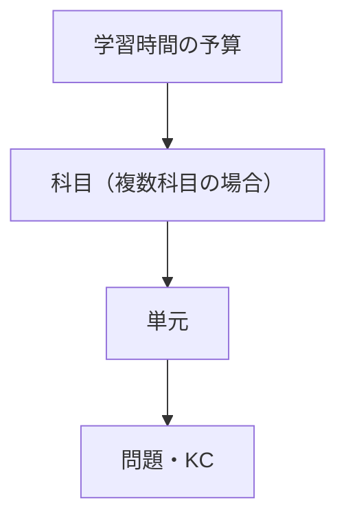
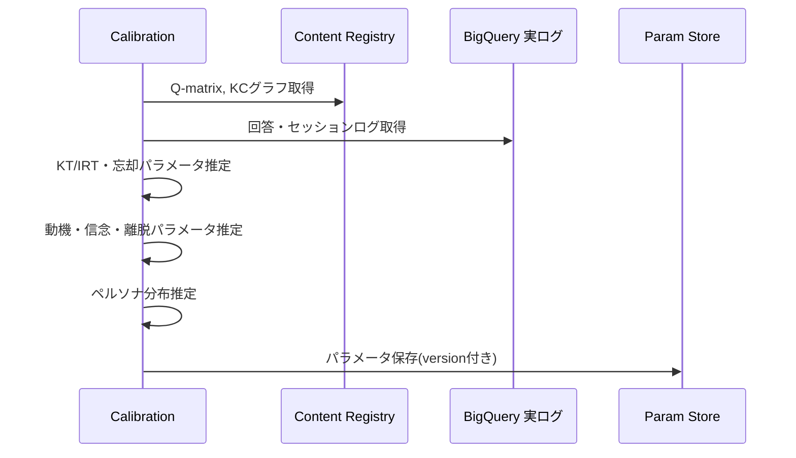
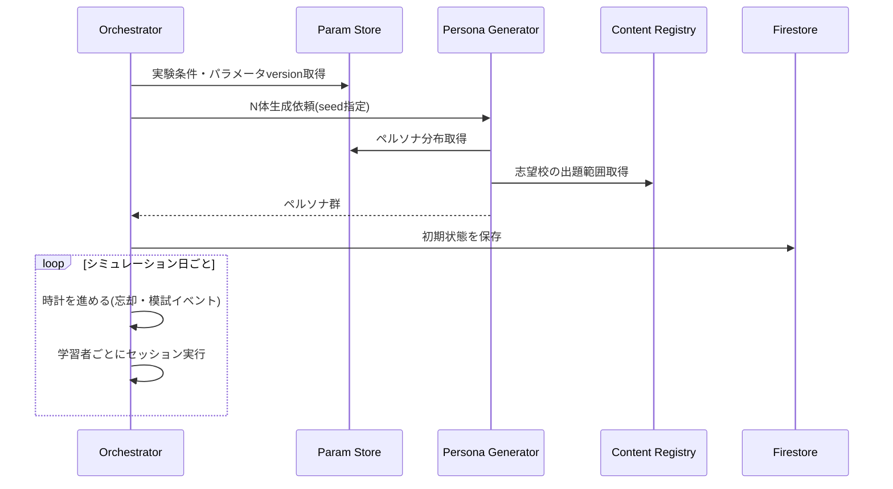
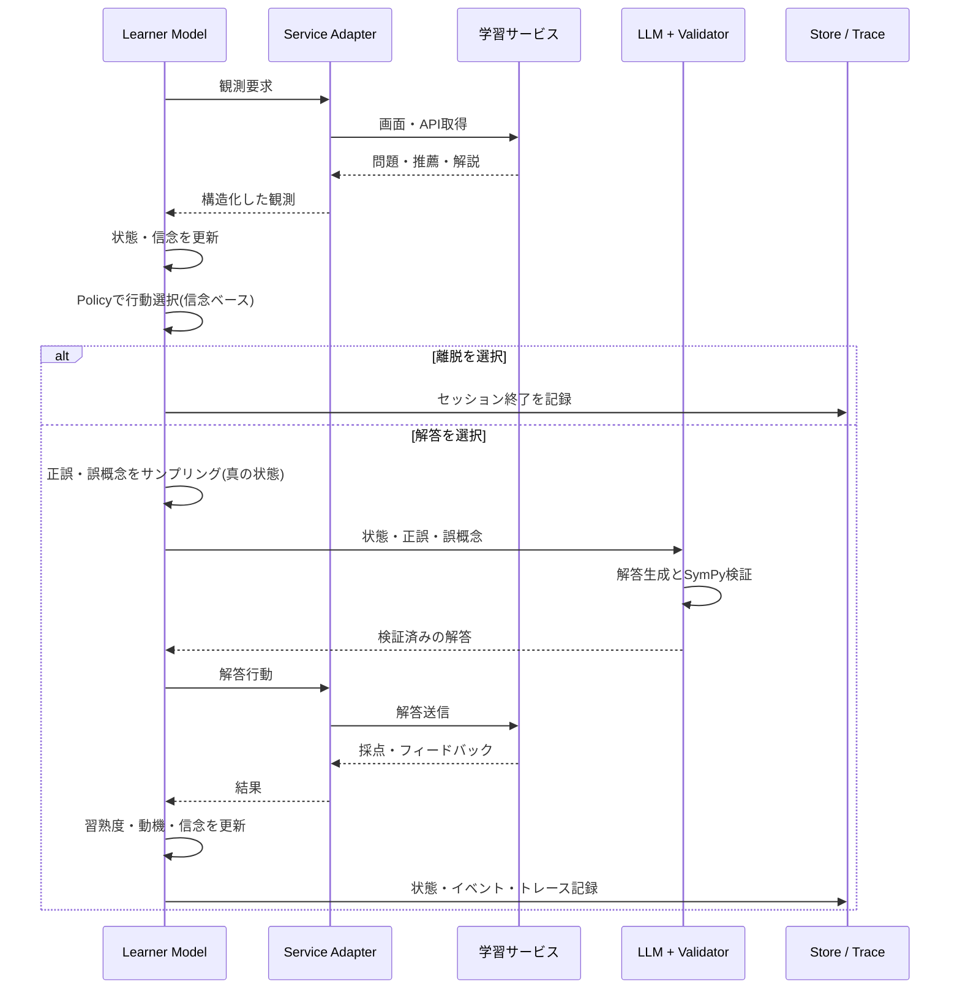
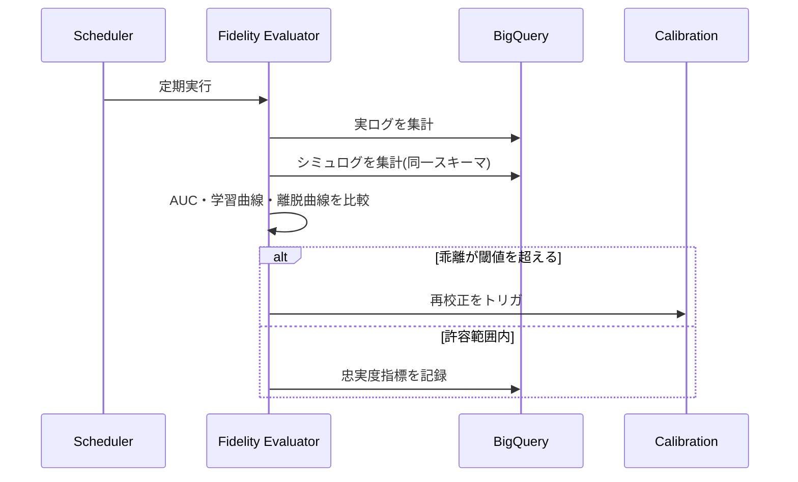
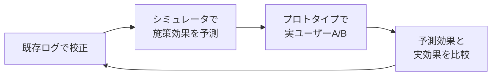

# 受験生模倣エージェント 設計整理

2026-09-21

## 目的と背景

大学の一般入試（数学）を目指す受験生を模倣するエージェント集団を作り、学習サービスのオンライン評価の代替とする。施策が受験生の学力・意欲・継続にどう効くかを、実ユーザーに出す前に見積もることが目的。実際の学習ログ（回答履歴・離脱データ）は利用できる前提とする。

設計の土台にする主な研究は次のとおり。

- 好奇心の理論：情報ギャップ理論（Loewenstein, 1994）、学習進捗仮説（Oudeyer, Gottlieb ら）、確信度に対する逆U字（Kang ら, 2009）、驚きによる記憶強化。
- 興味の発達：Hidi & Renninger の4段階モデル。知識が増えるほど好奇心が増える報酬学習フレームワーク（Murayama）。
- AIの内発的動機づけ：ICM、RND。新奇性だけを報酬にすると学習が止まる Noisy TV 問題。
- 学習者モデル：Knowledge Tracing（BKT、DKT）、IRT、KLI フレームワークの Knowledge Component（KC）、Learning Factors Analysis。
- Simulated Students：SimStudent、Generative Students（2024）、Agent4Edu（2025）。LLM単体では「できない学習者」を一貫して演じにくいことが既知の課題。
- 学習中の感情状態：Baker、D'Mello による混乱・退屈・フラストレーションの遷移。
- ユーザーシミュレータ：RecSim、KuaiSim、RecAgent。

## 設計原則

状態と確率は明示モデルで持ち、LLMは表層の表現だけを担当する。これで再現性・制御性・校正可能性を確保する。

1. **正誤や行動は確率モデルが決め、LLMはそれに沿った表現を書く。** LLMに「この学力の生徒として解いて」と任せると正答率を制御できない。
2. **真の状態と信念状態を分ける。** 正誤には真の習熟度を使い、行動選択には本人の認識（信念）を使う。学習者自身が部分観測下で意思決定している状況を再現する。
3. **合理的でない部分をモデル化する。** 苦手回避や気分による選択が、施策評価で最も知りたい部分になる。
4. **LLMの出力はスキーマで制約し、検証してから状態に反映する。**
5. **シミュレーションログは実ログと同じスキーマで出力する。** 忠実度評価と既存の分析クエリを両方に使える。

## 機能要件と非機能要件

8つの機能要件の枠組みは科目に依存しない。科目ごとに変わるのは各枠の中身で、Subject Pack として差し替える（後述）。

| # | 機能 | 内容 |
| --- | --- | --- |
| 1 | ペルソナ生成 | 志望校（出題範囲・難易度・記述式か）、残り日数、現在の学力、特性好奇心、勤勉さ、学習可能時間、メタ認知の精度。実ログから推定した分布で集団としてサンプリング |
| 2 | 認知状態モデル | KC単位の習熟度、前提関係グラフ、忘却、誤概念。入試特有の複数KC問題、記述の部分点、解法選択、時間制約 |
| 3 | 動機状態モデル | 好奇心、挑戦度（退屈⇔フラストレーション）、疲労、自己効力感、受験プレッシャー。直前期の探索低下、模試ショックなどの時期効果 |
| 4 | 信念状態モデル | 認識している選択肢集合、自己評価した習熟度、認識している出題範囲・配点 |
| 5 | 行動方針 | 科目・単元・問題の階層的な優先度選択、推薦への従い方、ヒント・解説・スキップ、継続・離脱、質問 |
| 6 | 応答生成 | 記述解答、誤答、質問文、チャットでの反応 |
| 7 | 状態遷移と時間進行 | インタラクションごとの状態更新、日・週単位の時計、忘却と模試イベント |
| 8 | サービス接続・校正・検証 | 評価対象サービスのAPI/UI操作、実ログからのパラメータ推定、実ログとの忠実度比較 |

非機能要件は次のとおり。

- 再現性：乱数シードと状態スナップショットで同じ実験を再実行できる。
- 制御性：状態を直接操作して条件を変えた実験ができる。
- スケール：数千体を並列実行できる。
- コスト：LLM呼び出しを自由記述が必要な場面に限定する。
- 可観測性：全ステップの状態ベクトル・行動・LLM入出力をトレースできる。

## 状態モデルの詳細

学習者の状態は「認知」「動機」「信念」の3つで持つ。認知は細かいKC単位、興味や好奇心の特性はトピック単位の粗い粒度で持つと推定が安定する。

### KC と Q-matrix

KCの粒度はログから経験的に決める。KCごとに練習回数×誤答率の学習曲線を描き、なめらかに下がれば適切、ガタガタなら粗すぎ、データが疎なら細かすぎと判断する。

1. カリキュラムの単元やタグで初期の Q-matrix を作る（LLMによるKC自動付与も初期案に有効）。
2. 学習曲線と Learning Factors Analysis で分割・統合を繰り返す。
3. KC間の前提関係グラフを持たせる。

一次方程式の例（KC は K1 移項、K2 同類項の整理、K3 係数で割る、K4 分配法則、K5 分数係数の処理、K6 立式）。

| 問題 | K1 | K2 | K3 | K4 | K5 | K6 |
| --- | --- | --- | --- | --- | --- | --- |
| 2x = 8 |  |  | ✓ |  |  |  |
| x + 5 = 12 | ✓ |  |  |  |  |  |
| 3x + 4 = 19 | ✓ |  | ✓ |  |  |  |
| 5x − 2 = 2x + 7 | ✓ | ✓ | ✓ |  |  |  |
| 2(x + 3) = 14 | ✓ |  | ✓ | ✓ |  |  |
| −3(x − 2) = 12 | ✓ |  | ✓ | ✓ |  |  |
| x/2 + 1/3 = 5/6 | ✓ |  | ✓ |  | ✓ |  |
| りんごの文章題 | ✓ |  | ✓ |  |  | ✓ |

負の係数の問題だけ誤答率が高止まりする場合、K4 を K4a（正の係数の分配）と K4b（負の係数の分配）に分割する。典型的な誤り「−3(x − 2) を −3x − 6 にする」は、そのまま誤概念として状態に持たせる。

### 認知状態

- KC単位の習熟度（BKT/IRT）と忘却（半減期回帰、FSRS系）。
- 誤概念は具体的な誤ったルールと発現確率で持つ。
- 複数KCの問題の正答確率は、KC習熟度の積で近似する。

### 動機状態と好奇心

挑戦度と好奇心は別の変数として持つ。挑戦度は習熟度と難易度のズレで決まり、好奇心は不確実性・学習進捗・驚きで決まる。

```latex
C = \text{trait} \times (w_1 \cdot U + w_2 \cdot LP + w_3 \cdot S)
```

U は不確実性（予測正答率 p が中間付近で最大、ピーク位置はログで推定）、LP は直近ウィンドウでの習熟度の上昇量、S は自信があったのに間違えたときの驚き。U は真の状態ではなく信念状態の不確実性で計算する。ギャップに気づかなければ好奇心は生まれないためである。

このほか、疲労、自己効力感、受験プレッシャー（目標とのギャップ）を持ち、離脱はこれらを入力にしたハザードモデルで表す。校正には、解説の閲覧・滞在時間、任意問題への着手、ヒントなしの再挑戦、質問頻度を代理指標として使う。

### 信念状態

- **認識している選択肢集合**：存在を知っている単元だけが選択肢になる。授業、サービスの表示、模試で触れるたびに広がる。
- **自己評価した習熟度**：真の習熟度に、ペルソナごとのバイアス（過信・過小評価）とノイズを加える。解いた直後の流暢性の錯覚も含める。
- **認識している出題範囲・配点**：志望校の実際の傾向とずれてよい。
- **メタ認知の精度**：信念と真の状態の近さ。フィードバックで改善し、模試は信念を真の状態に一気に近づけるイベントになる。

推定には、単元の選び方と真の弱点の乖離、模試の自己予想と実績の差を使う。サービス側で解答前の「自信あり／なし」を取得できれば、メタ認知の精度を直接推定できる。

### 特性パラメータ（性格）

性格は独立したモデルではなく、状態の変化の仕方を決めるペルソナの特性パラメータとして持つ。動機状態が「今どう感じているか」、特性は「どう感じやすいか」にあたる。特性好奇心や勤勉さもこの層に含める。

| 特性 | 効く場所 | パラメータの例 | ログからの推定 |
| --- | --- | --- | --- |
| 飽きやすさ | セッション内 | 同種の問題が続いたときの退屈の蓄積速度、新しさの減衰 | 同種問題の連続に伴うセッション内離脱率の上昇 |
| サボりやすさ | 日単位 | セッション開始の閾値、現在バイアス | セッション間の空白日数、締切前の学習量の急増 |
| 立ち直りやすさ | 失敗後 | フラストレーションや模試ショックからの回復速度 | 連続誤答や模試後に学習頻度が戻るまでの期間 |
| 計画性 | 行動選択 | Policy の温度 | 単元選択のばらつき |
| 外的報酬への反応 | 行動選択 | バッジや連続記録への感度 | 報酬施策の前後での行動変化 |

サボりやすさは双曲割引（β-δモデル）で表す。模試や入試が近づくと学習量が急に増えるパターンが自然に再現される。

推定は行動パラメータで行い、Big Five などのラベルは解釈用に後から対応づける（誠実性は継続、開放性は好奇心と関連）。特性と一時的な状態は少ないデータでは区別しにくいため、母集団分布を事前分布とする階層ベイズで個人ごとに推定する。

## 行動方針

優先度の選択は Nested Logit による階層的な選択として定式化する。科目内の単元選択も科目間の時間配分も同じ構造なので、科目の追加は階層を1段足すだけで済む。



下位の選択肢の効用を log-sum-exp で集約したものが上位の選択肢の効用になる。各選択肢の効用は次の形とし、softmax で選択する。

```latex
U = w_1 \cdot \text{期待得点増分} + w_2 \cdot \text{好奇心} - w_3 \cdot \text{苦手回避} + w_4 \cdot \text{推薦従順度}
```

- 期待得点増分：志望校の出題頻度・配点 × 伸びしろ × 伸びやすさ ÷ 時間。
- 選択肢集合と各項の入力は信念状態から取る。
- 重みと温度（計画通りか気分で動くか）はペルソナごとに変え、実ログの単元選択系列から推定する。

苦手単元を避けて得意単元ばかり解く偏りを w3 として推定できると、「サービスの推薦がこの偏りをどれだけ矯正できるか」を評価できる。

## アーキテクチャ

1人の学習者は LangGraph の StateGraph（直線＋条件分岐）で組む。認知・動機・信念モデルは「エージェント」ではなく計算モジュールなので、Supervisor パターンは学習者エピソードを管理するオーケストレーション側でのみ検討する。

| コンポーネント | 役割 | 実装イメージ |
| --- | --- | --- |
| Persona Generator | 分布から受験生集団を生成 | Python、設定は GCS |
| Cognitive Model | KC習熟度、忘却、誤概念、正誤サンプリング | 決定的な Python モジュール |
| Motivation Model | 好奇心・挑戦度・疲労・プレッシャーの更新、離脱ハザード | 同上 |
| Belief Model | 選択肢集合、自己評価、認識している出題範囲の更新 | 同上 |
| Policy | Nested Logit による階層的な行動選択 | 同上 |
| Response Generator | 決定済みの正誤・誤概念を条件に解答・質問文を生成 | Claude |
| Answer Validator | 意図した正誤と生成解答の一致を検証 | 数学は SymPy、不一致なら再生成 |
| Service Adapter | 評価対象サービスの API/UI 操作と観測のパース | サービスごとに差し替え |
| Content Registry | 問題バンク、Q-matrix、KCグラフ、志望校の出題傾向 | GCS / BigQuery |
| Simulation Orchestrator | 時計、集団、並列実行、実験条件（A/B） | Cloud Run Jobs |
| State Store | 学習者ごとの状態スナップショット | Firestore |
| Event Log | シミュレーションログ（実ログと同じスキーマ） | BigQuery |
| Param Store | 校正済みパラメータのバージョン管理 | GCS |
| Calibration Pipeline | 実ログから各モデルのパラメータを推定 | BigQuery → Python |
| Fidelity Evaluator | 正答予測AUC、学習曲線、セッション長、離脱曲線を実ログと比較 | 定期ジョブ |
| Observability | 状態ベクトル・行動・LLM入出力のトレース | Langfuse / Phoenix |

認知・動機・信念モデルは速度と決定性のためインプロセスのライブラリにする。外部から状態を覗く必要が出た段階で FastMCP で公開する。

## シーケンス

### 校正（オフライン）



### 起動と時間進行



### 1ステップ



### 忠実度評価と再校正



## 拡張・注意点・進め方

### LLMの役割拡張

決定は明示モデル、LLMは非構造な入力の解釈と表現の生成、という分担を保ったまま広げる。

- 行動方針側：推薦文・解説・チューター発話の構造化、週単位の学習計画の候補出し（選択は Policy）、解説が誤概念を解消するかの判定。
- 応答生成側：AIチューターとの多ターン対話、部分点のある不完全な記述答案、自己説明や感情的な反応。

### 科目展開

共通コアに、科目ごとの Subject Pack（KCグラフ、Q-matrix、Validator、誤概念ライブラリ、忘却パラメータ）を差し込む。

| 観点 | 数学 | 英語・記述系 |
| --- | --- | --- |
| KCの構造 | 手続き的で前提関係が深い階層 | 単語は独立項目で忘却が支配的、読解・作文はKC化しにくい |
| 正誤の検証 | SymPy で機械的に検証 | ルーブリックと LLM-as-judge、信頼性は下がる |
| 誤概念の表現 | 誤ったルール | 文法の誤り傾向や母語干渉などの確率的な癖 |

### 検証と注意点

- シミュレータ自体を実ログで検証する（正答予測AUC、学習曲線、セッション長、離脱曲線）。
- 動機・好奇心・メタ認知は正解ラベルが乏しく、代理指標での校正になる。
- シミュレータへの過剰最適化（Goodhart の法則）を避けるため、定期的に実データで再校正する。
- 新奇性だけで動く設計は Noisy TV 問題と同じく学習の伴わない行動を生むので、好奇心は学習進捗と結びつけて持つ。

### 進め方

1. MVP：数II の微分・積分など1単元に絞り、認知モデル・離脱ハザード・選択式問題で構築する。LLMは使わず、忠実度評価の仕組みを先に作る。
2. 動機・信念モデルと Nested Logit の Policy を追加し、解説閲覧・任意問題・継続率・単元選択の再現度を上げる。
3. LLM層（記述解答、誤答、質問文）と Validator を追加する。
4. 出題範囲の拡大、志望校の出題傾向、模試イベント、直前期の行動変化を入れる。複数科目は階層を1段足して対応する。

未決事項は、評価対象サービスを API 経由で操作できるか UI 経由になるか。Service Adapter の難易度とコストが大きく変わる。

## 検証用学習サービスのプロトタイプ

プロトタイプは、シミュレータの施策効果予測を実ユーザーで検証する介入実験の場として作る。既存ログだけでは現行施策下の行動しか分からず、施策を変えたときの予測精度を検証できないためである。

### 役割

1. 介入実験の場：推薦ロジックや UI を切り替えて実ユーザーで A/B を回し、予測効果と実効果を比較する。
2. 信号の計測：既存サービスで取れない自信度、解説の滞在時間、任意問題への着手などを取る。
3. シミュレータの接続先：人間とシミュレータが同じ API を使い、Service Adapter をほぼ不要にする。



シミュレータの最重要 KPI は施策効果の予測精度（向きと大きさ）とする。精度が確認できれば、実 A/B の前にシミュレータで施策を事前選別できる。

### 機能要件

| # | 機能 | 内容 |
| --- | --- | --- |
| 1 | オンボーディング | 志望校、学習可能時間、診断テスト、単元ごとの自己評価（信念状態の初期値） |
| 2 | コンテンツ | KC タグ付きの問題バンク、段階的ヒント、解説、任意問題 |
| 3 | 出題・推薦エンジン | 差し替え可能な複数ポリシー（ランダム、ルール、KT ベース、学習進捗ベースのバンディット）。実験の介入変数 |
| 4 | 解答・採点 | 選択式、数式入力（SymPy 判定）。記述の LLM 採点は後段 |
| 5 | 学習マップ | 単元の全体像と習熟度の可視化。信念と真の状態のずれを縮める施策の検証用 |
| 6 | 定期チェック | ミニ模試とその前の自己予想。真の学力と信念のずれを測る基準点 |
| 7 | 通知・リマインド | サボりやすさや離脱への介入の検証用 |
| 8 | 計測 | シミュレータと同じイベントスキーマ。解答前の自信度タップ、滞在時間、ヒント利用、セッション開始・終了 |
| 9 | 実験基盤 | 学習者単位の割付、フィーチャーフラグ、割付・露出ログ |
| 10 | 運営ダッシュボード | 実験群ごとの指標とシミュレータ予測の比較 |

AI チューターとの対話は LLM 層の検証段階で追加する。

### アーキテクチャ

API ファーストで作り、UI は API の薄い皮にする。シミュレータも同じ REST API を叩くので、人間とシミュレータのログが構造的に一致する。

| コンポーネント | 役割 | 実装イメージ |
| --- | --- | --- |
| Web UI | スマホ中心の薄いフロント | Cloud Run |
| Learning API | セッション、次の問題、解答送信、イベント受付 | FastAPI on Cloud Run |
| Recommender | ポリシーのプラグイン群 | Learning API から呼び出し |
| Experiment Service | 割付とフラグ管理 | Firestore に設定 |
| Grader | 数式判定（後で LLM 採点） | SymPy、Claude |
| Service Learner Model | 推薦用のオンライン KT | シミュレータの認知モデルとは別実装・別パラメータ |
| Content Registry | 問題、KC、Q-matrix | シミュレータと共有 |
| Event Pipeline | イベントのストリーミング取り込み | Pub/Sub → BigQuery（シミュログと同スキーマ） |
| State Store | 学習者状態、セッション | Firestore |

### 注意点

- 学習者モデルの循環を避ける：推薦用 KT とシミュレータの認知モデルが同じだと、モデルが自分に同意するだけの評価になる。
- 受験生は未成年が多い：保護者同意、個人情報の最小化、仮名化を最初から設計に入れる。
- 小規模 A/B の検出力：最初は効果の大きい介入（推薦の有無、学習マップの有無）で、予測の向きが合うかから確認する。

### シミュレータとの接続

人間は Web UI 経由、シミュレータは直接、同じ Learning API を叩く。そのために次を API 側に用意する。

- 時計の抽象化：シミュレーション環境でのみ、リクエストごとにシミュレーション時刻を渡せるようにする。忘却、通知、ミニ模試の日程はこの時計に従う。
- 通知の受け口：シミュレーション環境では通知をキューに流し、Orchestrator が読む。
- 提示情報のレスポンス：推薦の表示順や学習マップの強調内容など、画面で人間が見るものを API レスポンスに含める。純粋なレイアウトの違いは API シミュレーションでは評価できない。
- 再現性と負荷：推薦の乱数を実験ごとにシードで固定する。数千体の同時アクセスに耐えるスケール設定と、LLM 採点のキャッシュを用意する。

### 実ユーザー公開に向けた対応（後追い）

対象は受験生とし、プロトタイプは実際に使えるサービスとして公開する。以下はシミュレータとの接続・検証の目処が立ってから対応する。

- シミュレーションとの隔離：同じコードを本番とシミュレーション用の別環境（別プロジェクト、別データセット）にデプロイする。イベントに `is_simulated` フラグを持たせて二重に防ぐ。オンライン学習する推薦ポリシーがシミュレータの癖に引っ張られるのを防ぐため。
- 同意と規約：保護者同意、利用規約、プライバシーポリシー。
- 個人情報とセキュリティ：取得項目の最小化、仮名化、アクセス制御。
- 問題の品質：正答・採点の正確さを検証する仕組み。誤判定は信頼を大きく損なう。
- 問題の権利：大学入試の過去問は著作権があるため、オリジナル問題か許諾済みの問題を使う。
- 実験倫理：どの実験群もまともな学習方法にする（推薦なし群も教科書順の出題にするなど）。
- 集客：塾や学校との連携などで受験生の利用者を確保する。

### 進め方

1. シミュレータ MVP と同じ1単元で、選択式・数式問題、2種類の推薦ポリシー、計測、実験基盤を作る。シミュレータとの接続（時計、通知、提示情報）もここで入れる。
2. 自信度タップ、学習マップ、ミニ模試、通知を追加する（信念・特性の検証用）。
3. 記述問題の LLM 採点と AI チューターを追加する（LLM 層の検証用）。
4. 実ユーザー公開に向けた対応（後追い）を行い、受験生向けに公開して実ユーザー A/B を始める。
