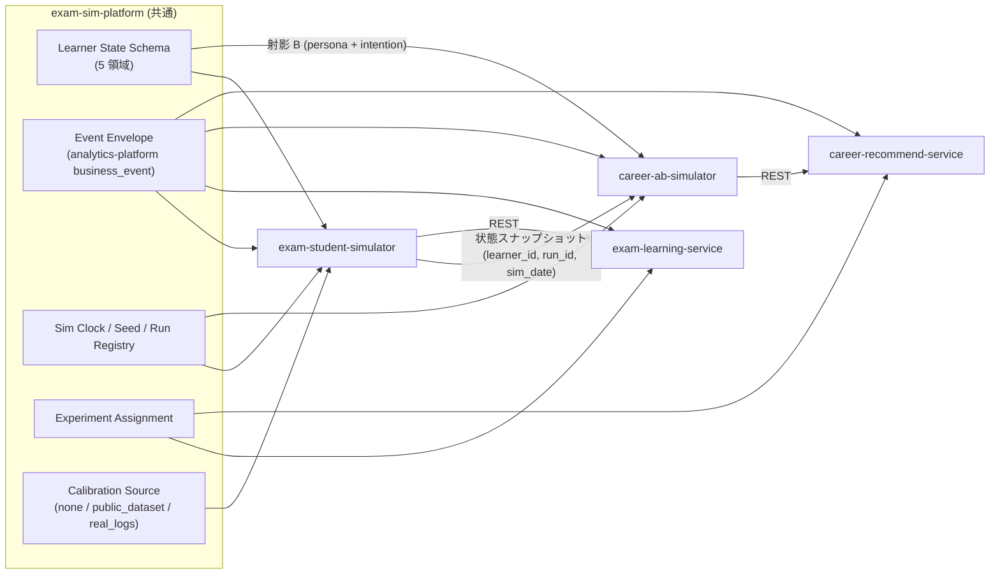
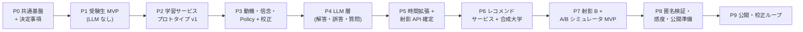

# PROPOSAL-0013: 受験生模倣エージェント + 進路レコメンド A/B シミュレータ

| | |
|---|---|
| **Status** | Draft |
| **Author** | @kurama554101 |
| **Created** | 2026-09-21 |
| **Updated** | 2026-09-22 |
| **Target** | exam-sim-platform (新規 cross-agent) / exam-student-simulator (新規) / exam-learning-service (新規) / career-recommend-service (新規) / career-ab-simulator (新規) |
| **Related PRs** | (none yet) |
| **Supersedes** | — |
| **Superseded by** | — |

---

## [必須] 1. Summary

大学一般入試 (数学) を目指す受験生を模倣するエージェント集団 (受験生シミュレータ) と、その学習者状態を共有して大学レコメンドサービスの UI・推薦ロジック変更を事前検証する A/B シミュレータ (進路シミュレータ) を、共通基盤 `exam-sim-platform` の上に構築する。両シミュレータの予測を実ユーザーで検証するため、学習サービスと大学レコメンドサービスの検証用プロトタイプも併せて作る。

本 proposal は、別々に書かれた 2 本の設計整理 (受験生模倣エージェント / 大学レコメンドシミュレータ) を 1 つの提案に統合したものである。統合した内容 (§3.1)、決定済み事項 (§3.2)、統合した提案に対して残る不明点 12 件 (§3.3) と課題点 14 件 (§3.4)、受験生シミュレータ → 進路シミュレータの順で進める 9 フェーズ (§3.5) を記載する。

## [必須] 2. Motivation

- 学習サービス・進路サービスの施策は、実ユーザー A/B ではトラフィック確保と数週間の待ち時間が要り、受験生向けサービスは受験スケジュールに利用が依存するため試せる時期そのものが限られる。LLM エージェントによる事前シミュレーションで施策候補を絞り込みたい。
- 学力・信念・特性が進路探索の行動を規定するため、学習側と進路側で学習者を別人格として作ると検証の意味が薄れる。両者は同一の学習者状態を共有する必要がある。
- 2 本の設計整理は接続面 (状態ストア、イベントスキーマ、時計、オーケストレータ、実験基盤) の定義が食い違っており、そのまま実装すると二重実装と別人格化が起きる。先に統合して接続面を固める。
- モノレポには analytics-platform (イベント収集 → GCS → BigQuery → dbt)、llm-client (Claude ラッパ)、shared-pg (Cloud SQL 集約、PROPOSAL-0009)、driving-license-bot (LLM 問題生成 + 自動 QA + 管理 UI) があり、新設せずに再利用できる。

### [必須] 2.1 Goals

- [ ] 受験生シミュレータと進路シミュレータが同一の Learner State Store を共有し、同じ学習者の学力変化が進路探索行動の変化として観察できる
- [ ] 両シミュレータのログと、両プロトタイプの実ユーザーログが同一イベントスキーマで analytics-platform に落ちる
- [ ] 施策効果の予測精度 (向き・順位) を最重要 KPI とする校正ループが、実ログの有無にかかわらず起動できる
- [ ] 共通部分 (状態スキーマ、イベントエンベロープ、時計、seed、割付) が `exam-sim-platform` に 1 箇所で定義される
- [ ] 実ユーザー (高校生以上) を受け入れる前提で、同意・PII 最小化・隔離が設計段階から入っている

### [必須] 2.2 Non-Goals

- 最終的な出願・受験結果の予測 (数か月の意思決定で家族・教師の影響が入るため、正解値にしない)
- 複数科目対応・AI チューター対話・ブラウザ方式 (Playwright) の設計 (Phase 9 以降の検討)
- 各コンポーネントの詳細設計 (KC グラフの中身、Nested Logit の重み、Recommend API の OpenAPI) は各フェーズの実装 PR と per-system DESIGN.md に委ねる
- 利用規約・プライバシーポリシーの文面作成

---

## [必須] 3. Proposal

### 3.1 統合した提案内容

#### 3.1.1 構成要素

5 つのパッケージで構成する。共通ライブラリを path dep で参照する構成は fujisawa-platform + fujisawa-info-bot と同じ。

| パッケージ | 役割 | 主な中身 |
|---|---|---|
| `exam-sim-platform` | 共通ライブラリ | Learner State Schema (5 領域、version 付き)、Event Envelope、Sim Clock、Seed / Run Registry、Experiment Assignment (学習者単位、バランス検査)、Calibration Source 抽象 (§3.1.7) |
| `exam-student-simulator` | 受験生シミュレータ | Persona Generator、Cognitive / Motivation / Belief Model、Policy (Nested Logit)、Response Generator (Claude)、Answer Validator (SymPy)、Service Adapter、Orchestrator、Calibration Pipeline、Fidelity Evaluator |
| `exam-learning-service` | 学習サービス プロトタイプ | Learning API (FastAPI)、Recommender (差し替え可能ポリシー)、Grader、Service Learner Model (シミュレータとは別実装の KT)、薄い Web UI |
| `career-recommend-service` | 大学レコメンド プロトタイプ | University Registry、Recommend API (検索 / 絞り込み / 詳細 / 比較 / 保存 / 資料請求)、Recommender (差し替え可能ポリシー)、薄い Web UI |
| `career-ab-simulator` | 進路 A/B シミュレータ | Agent Generation (射影 B)、Testing Preparation、Autonomous Simulation、Post-Testing Analysis、Environment Parsing (API レスポンス → JSON) |



#### 3.1.2 設計原則

1. **状態は 5 領域 (認知 / 動機 / 信念 / 特性 / 文脈)。正は受験生シミュレータ側。** 進路側は `(learner_id, run_id, sim_date)` で読み取る (読み取り専用)。
2. **サービスは状態ストアを見ない。** Learning API / Recommend API は人間と同じ入力 (オンボーディング、行動) しか受け取らない。推薦用の学習者モデルはシミュレータの認知モデルと別実装・別パラメータにする (循環回避)。
3. **決定は明示モデル、LLM は表現と候補内選好のみ。** 受験生側は正誤・行動を確率モデルが決め、LLM は解答文・質問文を書く。進路側も制約 (学力帯、費用、通学範囲) と探索予算・離脱 / 資料請求の生起率は特性由来の明示モデルが決め、LLM は候補校の選好順位だけを出す。
4. **真の状態と信念状態を分ける。** 正誤には真の習熟度、行動選択と LLM への入力には信念を使う。進路側の LLM に渡す学力帯は信念上の値で、真の値は評価指標 (検討校の難易度帯と真の学力帯の適合度) にだけ使う。
5. **合成学習者 + 合成大学で始める。** 実名大学・実ユーザー由来ペルソナは校正ループに入るまで使わない。LLM の「大学を知りすぎている」問題は合成大学 (匿名条件) がそのまま対策になる。
6. **共通部分は exam-sim-platform、ログは analytics-platform、LLM は llm-client、状態 / 設定は shared-pg。**
7. **進路側の主実験設計は対応比較。** 同じ学習者を同じ seed で両条件に流す。非対応 (学習者単位) 割付は人間 A/B の再現時のみ。
8. **パラメータは ablation で足す。** 追加ごとに忠実度指標の改善を記録する。

#### 3.1.3 受験生シミュレータ

- **状態モデル**: 認知 (KC 単位の習熟度 = BKT / IRT、半減期忘却、誤概念 = 誤ったルール + 発現確率、複数 KC 問題の正答確率は習熟度の積)、動機 (好奇心 = 特性 × (不確実性 + 学習進捗 + 驚き)、挑戦度、疲労、自己効力感、受験プレッシャー、離脱はこれらを入力にしたハザード)、信念 (認識している選択肢集合、自己評価した習熟度 = 真値 + バイアス + ノイズ、認識している出題範囲、メタ認知精度)、特性 (飽きやすさ、サボりやすさ = β-δ 双曲割引、立ち直りやすさ、計画性 = Policy 温度、外的報酬への反応、特性好奇心、リスク選好、志望の強さ)、文脈 (学年、時期、志望校 / 志望分野、残り日数、学習可能時間、通学可能範囲、費用制約、興味分野)。
- **KC と Q-matrix**: カリキュラムのタグで初期 Q-matrix を作り、学習曲線 (練習回数 × 誤答率) と Learning Factors Analysis で分割・統合する。KC 間の前提関係グラフを持つ。
- **行動方針**: Nested Logit による階層選択 (時間予算 → 科目 → 単元 → 問題)。効用 = 期待得点増分 + 好奇心 − 苦手回避 + 推薦従順度。入力は信念状態。重みと温度はペルソナごと。
- **LLM 層**: 決定済みの正誤・誤概念を条件に Claude が解答・誤答・質問文を生成し、SymPy で意図した正誤との一致を検証、不一致なら再生成。LLM 入出力は全件トレースし、再生モードでテストを決定的にする。
- **アーキテクチャ**: 1 学習者 = LangGraph StateGraph。認知・動機・信念モデルはインプロセスの決定的 Python モジュール。Orchestrator (Cloud Run Jobs) が時計・集団・並列・実験条件を管理。
- **校正と忠実度**: 正答予測 AUC、学習曲線、セッション長、離脱曲線、単元選択分布を比較。校正データの取り方は §3.1.7。

#### 3.1.4 学習サービス プロトタイプ

機能: オンボーディング (志望校、学習可能時間、診断テスト、単元ごとの自己評価)、KC タグ付き問題バンク (段階的ヒント、解説、任意問題)、差し替え可能な出題・推薦ポリシー (ランダム / ルール / KT ベース / 学習進捗バンディット)、解答・採点 (選択式、SymPy 数式判定、記述の LLM 採点は後段)、学習マップ、ミニ模試と自己予想、通知、計測 (自信度タップ、滞在時間、ヒント利用)、実験基盤、運営ダッシュボード。

シミュレータ接続のために API 側に持つもの: 時計の抽象化 (シミュレーション環境ではリクエストごとに時刻を渡す)、通知の受け口 (キューに流し Orchestrator が読む)、提示情報のレスポンス同梱 (推薦の表示順、学習マップの強調)、推薦乱数の seed 固定、LLM 採点のキャッシュ。

#### 3.1.5 進路 A/B シミュレータ

Agent A/B (CHI EA 2026) の 4 モジュール構成を踏襲し、中身を差し替える。

| モジュール | 役割 |
|---|---|
| Agent Generation | 状態スナップショットから **射影 B** (ペルソナ + intention) を生成。決定的テンプレート (信念上の学力帯、制約、志望分野、行動履歴要約) を埋めてから LLM で文章化する。intention は手書きせず状態から生成 (例: 「9 月模試で E 判定だったので、今の学力で届く範囲の情報系を探す」) |
| Testing Preparation | 対応比較を主設計。学力帯・志望分野・志望の強さの分布バランスを検査 |
| Autonomous Simulation | perceive–decide–act ループ。制約フィルタ・探索予算・Stop / RequestInfo のハザードは明示モデル、候補内の順位は LLM、最終行動は順位スコアの softmax (温度 = 特性) でサンプリング |
| Post-Testing Analysis | 群間の成果指標 (保存率、資料請求率、保存校数)、効率指標、探索の広がり (難易度帯の分散、越境率)、層別 (学力帯 / 志望分野 / 志望の強さ)、真の学力帯との適合度。BigQuery へ |

行動空間: Search / Filter / ViewDetail / Compare / Save / RequestInfo / Stop。環境アダプタは API 方式 (Recommend API を直接叩く) を主軸にし、ブラウザ方式は後回し。評価モードは施策種別で固定する: 推薦ロジック A/B → 行動シミュレーション、画面案の比較 → pairwise rating (2 案並べて 1〜10 評点)。提示順はエージェントごとにランダム化する。

#### 3.1.6 大学レコメンド プロトタイプ

機能: オンボーディング (現在の学力 = 模試結果または診断、志望分野、通学可能範囲、費用条件、志望の確信度)、University Registry (学部・学科単位、難易度帯、入試方式、費用、所在地、特色タグ)、差し替え可能な推薦ポリシー (人気順 / 条件マッチ / 学力適合 / 興味ベース協調フィルタ)、検索・絞り込み、比較、志望校リスト (チャレンジ / 実力相応 / 安全)、資料請求導線、計測 (滞在時間、除外理由タップ、確信度)、実験基盤、運営ダッシュボード。MVP の University Registry は合成校 (実名なし)。

#### 3.1.7 校正ループと校正データソース

```
校正データで校正 → シミュレータで施策効果を予測 → プロトタイプで実ユーザー A/B
 → 予測効果と実効果を比較 (符号一致、sign overlap) → 再校正
```

**既存の学習ログは無い** (§3.2)。そのため校正データソースを 3 段階で抽象化し、設定で切り替える。

| `CALIBRATION_SOURCE` | 使うデータ | 校正できるもの | 使う時期 |
|---|---|---|---|
| `none` | 合成データのみ | 自己整合性 (同 seed 再現、学習曲線の単調性、離脱曲線の形) | Phase 1 |
| `public_dataset` | 公開 KT データセット (§3.3 Q-5 で選定) | BKT / 忘却の事前分布の形、KC 粒度の判定手順の動作確認 | Phase 1〜3 |
| `real_logs` | プロトタイプが集めた実ユーザーログ、または将来入手する外部ログ | 認知 / 動機 / 信念 / 特性の全パラメータ、ペルソナ分布、忠実度評価 | Phase 9 以降、または外部ログ入手時 |

**実ログがある場合の設定方法** (将来、既存サービスのログや提携先のログが入手できた場合):

1. 実ログを Event Envelope (§4.3) に写像する **マッピング定義** (YAML) を書く。列名 → envelope フィールド、外部のスキルタグ → 内部 KC id、セッション境界の定義 (無操作 N 分で切る等)。
2. dbt の staging model で写像を実行し、`is_simulated=false` の envelope として analytics-platform に取り込む。プロトタイプ由来のログと同じ mart に落ちる。
3. Calibration Pipeline は envelope だけを読むので、実ログとプロトタイプログを区別なく推定に使える。学習者単位の最小イベント数 (既定 20) を下回る学習者は除外する。
4. KC 粒度は §3.1.3 の手順どおり学習曲線で判定する (`none` / `public_dataset` では判定手順の動作確認しかできないが、`real_logs` で初めて本番の粒度決定ができる)。
5. PII は取り込み時に仮名化する (学習者 id は Secret Manager のソルトで sha256、氏名・学校名は取り込まない)。

設定例 (Phase 0 で `exam-sim-platform` に置く):

```yaml
calibration:
  source: real_logs            # none | public_dataset | real_logs
  real_logs:
    backend: bigquery          # bigquery | jsonl
    table: analytics_marts.exam_events
    mapping: configs/mappings/<provider>.yaml
    min_events_per_learner: 20
    pseudonymize: true
  public_dataset:
    name: <dataset>
    kc_mapping: configs/mappings/<dataset>-kc.yaml
```

#### 3.1.8 実ユーザーと同意

公開対象は **高校生以上** (§3.2)。18 歳未満を含むため、次を公開前 (Phase 8) に設計する。

- オンボーディングで生年月または年齢区分を自己申告し、18 歳未満は保護者のメールアドレスに同意リンクを送り、同意完了までは体験モード (ログを校正・分析に使わない) に留める
- 取得項目の最小化: 氏名・学校名・住所は取らない。通学可能範囲は都道府県 / 通学時間の区分で持つ
- 実ユーザー由来のペルソナ生成は仮名化・集計済みシグナルからのみ行い、推定した属性は個人に紐づけず集団の条件付け変数としてだけ扱う
- 実験倫理: どの実験群もまともな学習方法にする (推薦なし群は教科書順の出題)
- 隔離: 本番とシミュレーション用で別環境 (別プロジェクト、別データセット) にデプロイし、加えて `is_simulated` フラグで二重に防ぐ

### 3.2 決定済み事項

| 論点 | 決定 | 反映先 |
|---|---|---|
| 既存の学習ログ | **無い**。ただし将来入手できた場合の取り込み手順を設計に含める | §3.1.7、§4.6 |
| 実ユーザーの範囲 | **高校生以上** (18 歳未満を含む) | §3.1.8、Phase 8 |
| 大学データの入手経路 | **未定** | §3.3 Q-8、Phase 8 で決定 |
| 対象サービスの操作方式 | 自前プロトタイプ + API 方式。外部サービスの UI 操作はスコープ外 | §3.1.5 |
| 状態ストアの共有形態 | 進路側は読み取り専用。書き戻しは Phase 9 で検討 | §3.1.2 原則 1、Q-2 |
| 進路側エージェントの出所 | MVP は合成学習者のみ。実ユーザー由来は Phase 9 | §3.1.2 原則 5、Q-4 |

### 3.3 不明点 (Q): 統合した提案に対して残るもの

| # | 論点 | 該当箇所 | なぜ困るか | 推奨する決め方 | 決める時期 |
|---|---|---|---|---|---|
| Q-1 | KC 粒度を実ログなしでどう決めるか | §3.1.3 KC と Q-matrix、§3.1.7 | 提案の粒度決定手順 (学習曲線で判定) は実ログ前提。合成データでは自分で決めた粒度が返ってくるだけ | Phase 1 はカリキュラム単元 + 解法ステップで手動定義した Q-matrix を「仮の粒度」とし、判定手順は `public_dataset` で動作確認だけする。本番粒度はプロトタイプログが溜まった時点 (Phase 9) で再判定 | Phase 1 (仮) / Phase 9 (本番) |
| Q-2 | 進路側から状態ストアへの書き戻し | §3.1.2 原則 1 | 進路探索で志望校が変わると、受験生側の期待得点増分 (志望校の出題傾向・配点) とプレッシャーが変わるはず。読み取り専用のままでは学習 → 進路の一方向しか再現できない | Phase 9 まで読み取り専用。書き戻すなら「志望校リスト更新」イベント 1 種に限定し、受験生側の文脈領域だけを更新する | Phase 9 |
| Q-3 | 数学のみの学力から「学力帯」への写像 | §3.1.3 (数学のみ)、§3.1.5 (学力帯で割付・制約) | 進路側は総合の学力帯 (偏差値帯相当) で制約と割付を行うが、受験生側は数学 1 科目しか状態を持たない | 文脈領域に科目別学力帯を持ち、数学は KT 由来、他科目は特性と同様に分布からサンプリングした静的値とする。総合学力帯は科目別の重み付き平均。複数科目化の際に置き換える | Phase 5 |
| Q-4 | 実ユーザー由来ペルソナへ切り替える条件 | §3.1.2 原則 5、§3.1.8 | 行動履歴 20 件未満のペルソナは LLM が一般論に流れる。実ユーザーが何人・何イベント溜まったら合成から切り替えるかが無い | 「同意済みかつ 20 イベント以上の学習者が 100 人」を暫定閾値にし、Phase 9 の校正ループ 1 周目で見直す | Phase 9 |
| Q-5 | 公開 KT データセットの選定とライセンス | §3.1.7 `public_dataset` | 公開データセットの科目・学年は数 II 微積と一致しない (中学数学、英語など)。何を校正できるかの期待値を合わせる必要がある | 校正対象を「BKT / 忘却パラメータの事前分布の形」と「KC 粒度判定手順の動作確認」に限定し、数値をそのまま使わない。候補とライセンスは Phase 1 の PR で比較表を付ける | Phase 1 |
| Q-6 | 問題バンクの生成・レビュー体制 | §3.1.4 問題バンク | 過去問は著作権で使えず、原問を LLM 生成する場合の正答検証 (SymPy) は最終式しか見ない。解説文・ヒントの誤りを誰がレビューするか | driving-license-bot の「LLM 生成 + 自動 QA + 管理 UI でレビュー」を流用し、レビューは作者 1 名で回せる件数 (Phase 1 は 1 単元数十問) に絞る | Phase 1 |
| Q-7 | 評価モードの施策別割当の妥当性 | §3.1.5 (行動 vs pairwise) | 「推薦ロジック → 行動、画面案 → pairwise」と固定したが、推薦結果の見せ方 (ハイライト・並び順) は両方にまたがる | Phase 7 で同一施策を両モードで走らせ、結論が一致するかを 1 度確認してから固定する | Phase 7 |
| Q-8 | 大学データの入手経路 (**未定**) | §3.1.6 University Registry | 学部・所在地・費用は公開情報から集められる見込みだが、難易度帯 (偏差値) は予備校の商用データで利用規約上スクレイピングできない可能性が高い | MVP は合成校で進める。実名化は Phase 8 で次の候補を比較して決める: (a) 公的な大学情報 DB + 各大学公式サイトのクロール (fujisawa-platform のクロール基盤を流用) で属性を集め、難易度帯は **ユーザーの自己申告 (模試判定) から推定**、(b) 予備校とのデータ提携、(c) 難易度帯だけ合成のまま実名を付ける (ブランド効果の測定用)。いずれも利用規約とライセンスを確認してから採用 | Phase 8 |
| Q-9 | 保護者同意の実装方式 | §3.1.8 | メールリンク方式は本人確認が弱い (本人が保護者メールを名乗れる)。塾・学校提携なら提携先が同意を取るが、集客経路が未定 | メールリンク方式を最小実装とし、同意の真正性は問わない代わりに取得項目を最小化する。提携先ができた時点で提携先経由の同意に切り替える | Phase 8 |
| Q-10 | shared-pg が状態書き込みに耐えるか | §3.1.2 原則 6 | 数千体 × ステップ単位のスナップショット書き込みは Postgres (db-g1-small) では詰まる可能性がある | Phase 1 はスナップショットを「日次 + セッション終了時」に間引き、ステップ単位のトレースは analytics-platform (JSONL) に流す。Phase 1 完了時に書き込みレートを計測し、上限を超えるなら Firestore に切り替える | Phase 1 |
| Q-11 | 記述解答の部分点判定 | §3.1.3 LLM 層、§3.1.4 採点 | SymPy は最終式の同値性しか検証できず、記述 (途中式・証明) の部分点はルーブリック + LLM-as-judge になり信頼性が下がる | MVP は選択式 + 数式入力に限定。記述は Phase 4 後半でルーブリック採点を入れ、人手採点との一致率を測ってから施策評価に使う | Phase 4 |
| Q-12 | 実ユーザーの集客経路と規模 | §3.1.8、Phase 9 | 校正ループは効果の大きい介入でも一定の実ユーザー数が要る。塾・学校提携か SNS かで同意フローも変わる | Phase 8 の完了条件に「集客経路の決定」を入れる。決まるまで Phase 9 に入らない | Phase 8 |

### 3.4 課題点 (I) と対応策: 統合した提案に対するもの

#### (a) 設計・実装

| # | 課題 | 該当箇所 | 対応策 |
|---|---|---|---|
| I-1 | 実ログ無しのため Phase 1〜3 の忠実度評価が自己整合性に留まる | §3.1.7 | 校正ソースを 3 段階で抽象化し (`none` / `public_dataset` / `real_logs`)、Calibration Pipeline と Fidelity Evaluator は envelope だけを読む実装にする。Phase 9 で実ログが入った時にコード変更なしで切り替わることを Phase 0 の契約テストで担保する |
| I-2 | 「サービスは状態ストアを見ない」の強制手段がレビュー頼み | §3.1.2 原則 2 | パッケージ依存で物理的に分離する。`exam-learning-service` / `career-recommend-service` は `exam_sim_platform.state` を import しない (import-linter で禁止)。状態スナップショット API はシミュレータ側のプロセスにだけ公開する |
| I-3 | 進路側のハイブリッド決定で LLM の順位出力が不安定 | §3.1.5 Autonomous Simulation | LLM には候補 id の順位付けだけをスキーマ制約付きで出させ、候補は最大 10 件に絞る。順位を Plackett-Luce 型のスコアに変換して softmax に渡す。同 seed の再実行は再生モードで決定的にする |
| I-4 | 進路側のオンボーディング入力と信念状態の整合 | §3.1.2 原則 4、§3.1.6 オンボーディング | エージェントが Recommend API のオンボーディングに入力する「現在の学力」も信念上の値にする (人間も自己申告するため)。真の学力帯は評価指標にだけ使う。この対応を射影 B のテンプレートで固定する |
| I-5 | 対応比較での乱数の扱い | §3.1.2 原則 7 | 共通乱数法 (CRN) を採る。学習者ごとの seed から「ペルソナ生成」「行動サンプリング」「LLM 呼出」の乱数列を分離して派生させ、条件間で同じ列を使う。条件差は環境 (Recommend API の応答) からだけ生じる |
| I-6 | 合成大学だけでは実名条件 (ブランド効果) が測れない | §3.1.2 原則 5、§3.1.6 | Phase 8 で「属性は合成のまま実在校名だけを付ける」条件を追加し、匿名条件との差をブランド効果として測る。実在校名の使用は事実と異なる属性を紐づけるため、シミュレータ内部に限り、プロトタイプ (実ユーザー) には出さない |
| I-7 | 学習側でも LLM が「解けてしまう」ため誤答生成が難しい | §3.1.3 LLM 層 | 誤答は誤概念ライブラリ (誤ったルール) を条件にテンプレートで途中式を崩してから LLM に文章化させる。Validator の不一致率と再生成回数を計測し、閾値超過は誤概念ライブラリ側を直す |
| I-8 | 二重実装の圧縮範囲を過大に見積もっている | §3.1.1 | UI は学習と進路で画面が違うため共有できない。共有するのは計測 SDK (envelope)、割付、時計ヘッダ、`SIM_MODE` の 4 点に限定し、Phase 0 の成果物をそれに合わせる |

#### (b) データ・校正

| # | 課題 | 該当箇所 | 対応策 |
|---|---|---|---|
| I-9 | パラメータ過多で識別できない | §3.1.3 状態モデル | Ablation 前提で足す。Phase 1 は BKT + 忘却 + 離脱ハザード + 特性 1 種 (サボりやすさ)。忠実度指標が頭打ちになった項目にだけ追加し、追加ごとに指標の改善を台帳に記録する |
| I-10 | 進路側に正解データが無い | §3.1.5 | 行動ユニットテストを先に作り CI で回す: (1) 単調性 (学力帯が上がると検討校の難易度帯の中央値が上がる)、(2) 制約遵守 (通学範囲・費用制約外の校が Save されない)、(3) 感度 (推薦ロジック A/B で匿名条件でも群間差が出る)、(4) ダミー校 (属性が同じなら名前の有無で選好が変わらない) |
| I-11 | analytics-platform が現状ローカル運用 | §3.1.2 原則 6 | 本提案の BigQuery 前提は analytics-platform の GCP 配備 (PROPOSAL-0010) に依存する。Phase 1〜4 はローカル backend (JSONL + DuckDB + dbt) で進め、Phase 5 までに GCP 配備が済んでいなければ Phase 6 以降も DuckDB で続行できるようにする |

#### (c) LLM 制御・コスト

| # | 課題 | 該当箇所 | 対応策 |
|---|---|---|---|
| I-12 | LLM 費用が個人運営の規模に合わない (Agent A/B の事例は 1,000 体で約 2,925 ドル) | §3.1.5 | 1 run = 100 体 × 2 条件を上限にする。llm-client の prompt caching でペルソナ + 大学カードをキャッシュし、順位付けは小型モデル、文章化のみ中型モデル。Phase 7 で 1 run の費用を実測して上限を確定。受験生側は Phase 1〜3 で LLM を使わない |
| I-13 | 再現性 | §3.1.3 LLM 層、§3.1.5 | LLM 入出力を analytics-platform の `llm_call` に全件保存し、再生モード (記録済み応答を返す) を Service Adapter と同じ層に置く。テストは再生モードで回す |

#### (d) 法務・倫理

| # | 課題 | 該当箇所 | 対応策 |
|---|---|---|---|
| I-14 | 18 歳未満を含む公開に必要な事項が Phase 9 直前に集中する | §3.1.8 | Phase 8 の完了条件に「保護者同意フローの実装」「取得項目の最小化レビュー」「問題バンクが全件オリジナルであることの確認」「全実験群の妥当性レビュー」「集客経路の決定」を入れ、公開フェーズと切り離す |

### 3.5 実装フェーズ

受験生シミュレータ → 進路シミュレータの順。各フェーズは 1〜数 PR、完了条件を満たしたら次へ進む。**Phase 0 と Phase 5 が両者の接続点** で、ここで決めたスキーマ / 射影 API が進路側の入力になる。Phase 6 は Phase 5 と並行して着手できる。



#### Phase 0: 共通基盤と決定事項 (exam-sim-platform)

| | |
|---|---|
| 目的 | 接続面を先に固める |
| 成果物 | `exam-sim-platform/`: Learner State Schema (pydantic、5 領域、version)、Event Envelope、Sim Clock、Seed / Run Registry (CRN 用の乱数列派生を含む)、Experiment Assignment、Calibration Source 抽象 (`none` / `public_dataset` / `real_logs`) とマッピング定義の読み込み、import-linter 設定 (I-2)。各パッケージの per-system DESIGN.md 雛形。ストレージ判断 (shared-pg 第一候補) の記録 |
| 既存資産 | analytics-platform (`AnalyticsLogger`)、docs/SYSTEM_DESIGN_TEMPLATE.md、PROPOSAL-0009 |
| 完了条件 | 状態スキーマのレビュー完了。envelope の `is_simulated` 必須化と Calibration Source の切替が契約テストで通る |

#### Phase 1: 受験生シミュレータ MVP (LLM なし)

| | |
|---|---|
| 目的 | 1 単元 (数 II 微分・積分) で認知モデル + 離脱ハザードを動かし、忠実度評価の仕組みを先に作る |
| 成果物 | `exam-student-simulator/`: Content Registry (手動定義の Q-matrix、KC グラフ、選択式問題。生成 + QA + 管理 UI は driving-license-bot を流用)、Cognitive Model (BKT + 半減期忘却 + 誤概念 1〜2 種)、Motivation Model 最小版 (離脱ハザード)、特性 1 種 (サボりやすさ)、Persona Generator (分布 + seed)、Orchestrator (日単位の時計、N 体並列、in-process のモック Learning API)、Event Log、Fidelity Evaluator (正答予測 AUC、学習曲線、セッション長、離脱曲線)、Calibration Pipeline (`none` と `public_dataset`)、Ablation 台帳 |
| 完了条件 | 同 seed で全ステップが再現する。`public_dataset` で校正パイプラインが端から端まで動く (数値は使わない)。スナップショット書き込みレートを計測し shared-pg 継続可否を判断 (Q-10) |

#### Phase 2: 学習サービス プロトタイプ v1

| | |
|---|---|
| 目的 | シミュレータが REST で叩ける本物の API を用意し、モックを置き換える |
| 成果物 | `exam-learning-service/`: Learning API (セッション、次の問題、解答送信、イベント受付)、Recommender 2 ポリシー (ランダム / ルール)、Grader (選択式 + SymPy)、Service Learner Model (別実装の簡易 KT)、Experiment Service (Phase 0 の割付)、シミュレータ接続 3 点 (時計ヘッダ、通知キュー、提示情報同梱)、`SIM_MODE`、薄い Web UI |
| 完了条件 | Phase 1 のシミュレータが Service Adapter 経由で同じ忠実度指標を再現する。人間が Web UI から 1 セッション完走でき、同じ envelope でログが落ちる。サービスが `exam_sim_platform.state` を import していないことを import-linter が保証 |

#### Phase 3: 動機・信念モデルと Policy、校正

| | |
|---|---|
| 目的 | 合理的でない部分を入れ、単元選択・解説閲覧・継続率の再現度を上げる |
| 成果物 | Motivation Model (好奇心、挑戦度、疲労、自己効力感)、Belief Model、Policy (Nested Logit)、残りの特性、Calibration Pipeline (階層ベイズ)、Fidelity Evaluator 拡張。プロトタイプに自信度タップ・学習マップ・ミニ模試を追加 |
| 完了条件 | Ablation 台帳で各パラメータ追加が忠実度指標を改善したことを記録 |

#### Phase 4: LLM 層と Validator

| | |
|---|---|
| 目的 | 決定済みの正誤・誤概念を条件に、Claude で解答・誤答・質問文を生成する |
| 成果物 | Response Generator (llm-client、スキーマ制約付き)、誤答テンプレート (I-7)、Answer Validator (SymPy、不一致は再生成)、再生モード、LLM トレース (`llm_call`)、プロトタイプ側の数式入力 UI、後半で記述問題のルーブリック採点 (Q-11) |
| 完了条件 | Validator 不一致率、再生成回数、1 セッションあたりの LLM 呼出数と費用を記録。再生モードでテストが決定的に通る |

#### Phase 5: 時間拡張と射影 API の確定 (進路側への引き渡し点)

| | |
|---|---|
| 目的 | 模試イベント・志望校の出題傾向・直前期の行動変化を入れ、進路側が必要とする読み出し口を確定する |
| 成果物 | 模試イベント (信念を真の状態に近づける)、期待得点増分への出題傾向反映、直前期の探索低下、状態スナップショット API (§4.4)、科目別学力帯 (Q-3)、文脈領域の充填、行動履歴要約 (20 件判定) |
| 完了条件 | 7 月 / 9 月 / 12 月のスナップショットが同一 run から取れ、学力帯と信念のずれが時点間で変化する。射影 API の契約テスト (進路側の消費者テスト) が通る |

#### Phase 6: 大学レコメンド プロトタイプ v1 + 合成大学レジストリ

| | |
|---|---|
| 目的 | Recommend API と 2 種類の推薦ポリシーを合成校で動かす |
| 成果物 | `career-recommend-service/`: University Registry (合成校)、Recommend API (提示順とハイライト情報を同梱)、Recommender 2 ポリシー (人気順 / 学力適合)、Experiment Service、`SIM_MODE`、薄い Web UI |
| 完了条件 | 人間が Web UI でオンボーディング → 検索 → 保存 → 資料請求まで通り、行動空間 7 種が envelope で記録される。import-linter で状態ストア非依存を保証 |

#### Phase 7: 射影 B と A/B シミュレータ MVP (API 方式)

| | |
|---|---|
| 目的 | 状態からペルソナ + intention を生成し、4 モジュールを API 方式で回す |
| 成果物 | `career-ab-simulator/`: Agent Generation (射影 B、信念上の学力帯を渡す)、Testing Preparation (対応比較 + CRN)、Autonomous Simulation (ハイブリッド決定)、Environment Parsing、Post-Testing Analysis、行動ユニットテスト 4 種、再生モード、コスト計測、pairwise rating モード。射影 B 出力数体分の人手レビュー記録。評価モードの割当確認 (Q-7) |
| 完了条件 | 100 体 × 2 条件の run が完走し、1 run の費用が記録される。行動ユニットテスト 4 種が通る |

#### Phase 8: 匿名条件検証・感度確認・公開準備

| | |
|---|---|
| 目的 | シミュレータの感度を確認し、公開前に決めるべき事項を全て埋める |
| 成果物 | 匿名 / 実名 (属性は合成のまま実在校名のみ、I-6) の同一実験、ダミー校混入テスト、提示順ランダム化、感度レポート。公開準備: 保護者同意フロー (§3.1.8)、取得項目の最小化レビュー、隔離設定 (別環境 + `is_simulated`)、問題バンクの権利確認、実験群の妥当性レビュー、運営ダッシュボード、大学データ入手経路の決定 (Q-8)、集客経路の決定 (Q-12) |
| 完了条件 | 匿名条件で推薦ロジック A/B の群間差が検出される (出なければ感度不足として Phase 7 に戻る)。公開判断に必要な決定事項が全て埋まっている |

#### Phase 9: 公開と校正ループ

| | |
|---|---|
| 目的 | 実ユーザーで効果の大きい介入から A/B を回し、予測の向きが合うかを確認する |
| 成果物 | 両プロトタイプの公開 (別環境)、実ユーザー A/B (推薦あり / なし、学習マップあり / なし、比較機能あり / なし)、`CALIBRATION_SOURCE=real_logs` への切替、予測効果と実効果の比較 (符号一致、sign overlap)、再校正、実ユーザー由来ペルソナへの切替判断 (Q-4)、KC 粒度の本番判定 (Q-1)、書き戻しの検討 (Q-2) |
| 完了条件 | 最初の介入について予測の符号が実測と一致し、校正ループが 1 周する |

#### 以降 (フェーズ外)

- ブラウザ方式 (Playwright) の Environment Parsing / Action Execution
- 複数科目 (Subject Pack、階層を 1 段追加)、AI チューター対話
- 進路探索 → 学習優先度の双方向ループ

### [推奨] 3.6 Notes / Constraints / Caveats

- Phase 1〜3 は LLM を使わないので、費用はほぼ Cloud Run Jobs と Cloud SQL のみ。LLM 費用が発生するのは Phase 4 以降
- 両シミュレータとも「絶対値ではなく群間差の方向と順位」を評価対象にする。人間 (探索的) とエージェント (目的志向) で行動数は揃わない前提
- 忠実度の絶対値目標は置かない。校正ループの 1 周目で予測の符号が合うことを最初のマイルストーンにする

### [必須] 3.7 Risks and Mitigations

| リスク | 影響度 | 対策 |
|---|---|---|
| 状態スキーマが後から変わり、両シミュレータの互換が壊れる | High | pydantic スキーマ + version、Phase 5 の射影 API に契約テスト |
| 実ログ無しで忠実度評価が形式的になり、Phase 9 で大きく作り直す | High | Calibration Source の 3 段階抽象化。envelope だけを読む実装で、実ログ投入時にコード変更を不要にする |
| 推薦エンジンがシミュレータの真の状態を見て循環する | Medium | import-linter でパッケージ依存を禁止。Service Learner Model は別実装 |
| LLM の追従性で進路側の成果指標が天井に張り付く | Medium | Stop / RequestInfo の生起率を明示モデル側に持つ。行動ユニットテストの「感度」で検出 |
| LLM 費用の超過 | Medium | 1 run 100 体 × 2 条件の上限、prompt caching、Phase 7 で実測して上限確定 |
| 18 歳未満の PII | High | 合成学習者のみで Phase 8 まで進める。保護者同意完了までは体験モード。取得項目の最小化 |
| 問題バンクの著作権 | Medium | 原問のみ。生成 + SymPy 検証 + 管理 UI レビュー |
| 実在校名に合成属性を付けた条件が外に漏れる | Medium | シミュレータ内部限定。プロトタイプの University Registry には入れない |

---

## [必須] 4. Design Details

### 4.1 リポジトリ構成

```text
exam-sim-platform/          # 共通ライブラリ (path dep)
  exam_sim_platform/
    state/                  # Learner State Schema (5 領域、version 付き)
    events/                 # Event Envelope (analytics-platform business_event 準拠)
    clock.py                # Sim Clock
    runs.py                 # Run Registry (run_id, seed, cohort, condition, CRN 乱数列派生)
    experiment/             # 割付 + バランス検査
    calibration/            # Calibration Source 抽象 + マッピング定義の読み込み
  configs/mappings/         # 実ログ / 公開データセットの envelope 写像定義
exam-student-simulator/     # 受験生シミュレータ
exam-learning-service/      # 学習サービス プロトタイプ (Learning API + UI)
career-recommend-service/   # 大学レコメンド プロトタイプ (Recommend API + UI)
career-ab-simulator/        # 進路 A/B シミュレータ
```

import-linter で `exam-learning-service` / `career-recommend-service` から `exam_sim_platform.state` への依存を禁止する。

### 4.2 Learner State Schema (5 領域)

| 領域 | 内容 | 更新 owner | 進路側での使われ方 |
|---|---|---|---|
| 認知 | KC 別習熟度、忘却、誤概念 | 受験生シミュレータ | 科目別学力帯の推定元 |
| 動機 | 好奇心、挑戦度、疲労、自己効力感、受験プレッシャー | 受験生シミュレータ | 離脱ハザード、探索予算 |
| 信念 | 認識している選択肢集合、自己評価した習熟度、認識している出題範囲、メタ認知精度 | 受験生シミュレータ | LLM に渡す「信念上の学力帯」、オンボーディング入力 |
| 特性 | 飽きやすさ、サボりやすさ、立ち直りやすさ、計画性 (温度)、外的報酬への反応、特性好奇心、リスク選好、志望の強さ | Persona Generator (生成時に固定) | 割付バランス、softmax 温度、ハザード |
| 文脈 | 学年、時期、志望校 / 志望分野、残り日数、学習可能時間、通学可能範囲、費用制約、興味分野、科目別学力帯 (数学以外は静的) | Persona Generator + 模試イベント | intention 生成、制約フィルタ |

### 4.3 Event Envelope

```json
{
  "learner_id": "L-000123",
  "run_id": "run-2026-09-21-abc",
  "is_simulated": true,
  "sim_time": "2026-09-15T20:10:00+09:00",
  "service": "exam-learning-service | career-recommend-service",
  "condition": "control | treatment",
  "event_type": "answer_submitted | unit_selected | session_ended | search | filter | view_detail | compare | save | request_info | stop",
  "payload": {}
}
```

analytics-platform の `business_event` にそのまま載せ、`is_simulated` は必須項目とする。実ユーザーのログは `is_simulated=false`、`run_id` は null。

### 4.4 状態スナップショット API (Phase 5)

```text
GET /snapshots/{learner_id}?run_id=...&sim_date=YYYY-MM-DD
→ { state (5 領域), behavior_summary (行動履歴要約, event_count), schema_version }
```

読み取り専用。進路側の Agent Generation はこのレスポンスからのみペルソナと intention を作る。シミュレータ側のプロセスにだけ公開し、サービスからは到達できない。

### [必須] 4.5 Test Plan

- **Unit**: 状態スキーマのバリデーション、envelope の `is_simulated` 必須、Sim Clock の日送りと忘却、BKT / ハザードの決定性 (同 seed 同出力)、CRN の乱数列分離、Nested Logit の log-sum-exp、Calibration Source の切替とマッピング定義の読み込み
- **Integration**: シミュレータ → Learning API / Recommend API の往復、Experiment Service の割付バランス検査、射影 API の契約テスト、再生モードでの LLM 層テスト、`real_logs` 用マッピングを合成 envelope に適用して Calibration Pipeline が動く (実ログ投入前の疎通)
- **行動ユニットテスト (進路側)**: 単調性 / 制約遵守 / 感度 / ダミー校
- **静的検査**: import-linter による状態ストア非依存
- **Manual / E2E**: Web UI からの 1 セッション完走 (両プロトタイプ)、射影 B の出力数体分の人手レビュー、保護者同意フローの通し確認

### [推奨] 4.6 Migration / Rollback

- 実ログ投入は `CALIBRATION_SOURCE` の切替とマッピング定義の追加のみで、スキーマ変更を伴わない。戻すときは `public_dataset` に戻す
- 状態スキーマの version 更新時は、旧 version のスナップショットを読める変換関数を同じ PR で入れる

### [推奨] 4.7 Feature Enablement

- `SIM_MODE=1`: シミュレーション向け機能 (時計ヘッダ受付、通知キュー、提示情報同梱) を有効化。本番環境では無効
- `CALIBRATION_SOURCE=none|public_dataset|real_logs`: 校正データソース (§3.1.7)
- `ANALYTICS_STORAGE_BACKEND=local|gcs`: analytics-platform の既存切替をそのまま使う

---

## [推奨] 5. Operational Concerns

### 5.3 Dependencies

- analytics-platform (イベント収集、dbt。GCP 配備は PROPOSAL-0010 に依存)、llm-client (Claude 呼び出し、prompt caching)、shared-pg (Cloud SQL)、driving-license-bot (問題生成 + QA + 管理 UI の流用元)、fujisawa-platform (大学公式サイトのクロール基盤の流用候補)
- 公開 KT データセット (Phase 1)。ライセンスは採用時に確認

### [推奨] 5.4 Non-Functional Requirements

#### コスト
- Phase 1〜3: LLM なし。Cloud Run Jobs + Cloud SQL のみ
- Phase 4 以降: 1 セッションあたりの LLM 呼出数を計測し、Phase 7 で 1 run (100 体 × 2 条件) の上限費用を決める
- 公開時: Cloud Run 2 サービス + shared-pg に DB 追加。PROPOSAL-0009 の月額予算と整合させる

#### プライバシー / データ保持
- Phase 8 まで合成学習者のみ。実ユーザーログは仮名化 (ソルト付き sha256) した上で analytics-platform の方針 (PII は hash) に従う
- 18 歳未満は保護者同意完了までログを校正・分析に使わない

---

## [必須] 7. Alternatives

### 案 A: 進路シミュレータを静的ペルソナで先に独立に作る
- 概要: Agent A/B の論文どおり静的ペルソナで進路シミュレータを先に立ち上げ、状態ストアとの接続は後回しにする
- 却下理由: 学力・信念が時間変化する動的状態を後から繋ぎ直すと射影 B とペルソナ生成を作り直すことになる。受験生 → 進路の順で進める方針とも合わない

### 案 B: 進路側も完全に明示モデル化し、LLM を使わない
- 概要: 進路探索も Nested Logit のような効用モデルで決める
- 却下理由: 進路探索には KT に相当する校正済みモデルが無く、大学の特色や説明文の解釈は LLM の方が現実的。制約と生起率のみ明示モデルに寄せるハイブリッドを採る

### 案 C: プロトタイプを 1 サービスに統合する
- 概要: Learning API と Recommend API を 1 つの FastAPI にまとめる
- 却下理由: 介入変数 (出題推薦 vs 大学推薦) と成果指標が異なり、実験の隔離が難しくなる。共通部分はライブラリで共有し、アプリは分ける

### 案 D: 実ログが入手できるまで校正パイプラインを作らない
- 概要: Phase 1 の忠実度評価を省き、実ユーザー公開後に校正を始める
- 却下理由: 校正パイプラインと Fidelity Evaluator が無いと、Phase 3 の ablation (パラメータを足す根拠) が回らない。合成 + 公開データで手順を先に固め、実ログ投入時にコード変更なしで切り替える方が安い

---

## [必須] 8. Implementation History

| 日付 | 種別 | 内容 |
|---|---|---|
| 2026-09-21 | Draft | 初稿。2 本の設計整理を統合し、不明点 12・課題点 14 と 9 フェーズ案を記載 |
| 2026-09-22 | Draft | 決定事項を反映 (既存ログなし + 実ログ投入時の設定方法、実ユーザーは高校生以上、大学データ入手経路は未定)。元ドキュメントはリポジトリに含めない方針に変更 |
