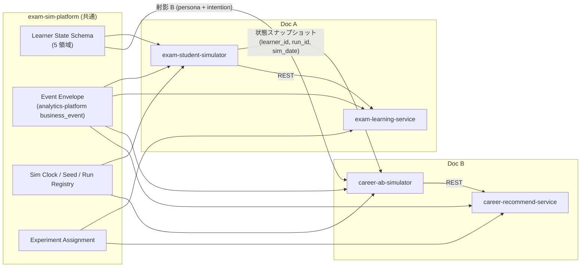
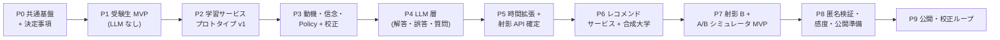

# PROPOSAL-0013: 受験生模倣エージェント + 進路レコメンド A/B シミュレータ（設計レビューと実装フェーズ）

| | |
|---|---|
| **Status** | Draft |
| **Author** | @kurama554101 |
| **Created** | 2026-09-21 |
| **Updated** | 2026-09-21 |
| **Target** | exam-student-simulator (新規) / career-ab-simulator (新規) / exam-sim-platform (新規 cross-agent) |
| **Related PRs** | (none yet) |
| **Supersedes** | — |
| **Superseded by** | — |

**レビュー対象ドキュメント** (本 proposal と同時に取り込み):

| 略称 | ファイル | 内容 |
|---|---|---|
| **Doc A** | [`0013-assets/exam-student-simulator-design.md`](0013-assets/exam-student-simulator-design.md) | 受験生模倣エージェント 設計整理 (学習サービスの施策評価用シミュレータ + 検証用学習サービスのプロトタイプ) |
| **Doc B** | [`0013-assets/university-recommend-simulator-design.md`](0013-assets/university-recommend-simulator-design.md) | 大学レコメンドサービスのシミュレータ設計 (Agent A/B ベース + 検証用レコメンドサービスのプロトタイプ) |

---

## [必須] 1. Summary

Doc A (受験生模倣エージェント) と Doc B (進路レコメンド A/B シミュレータ) は「同一の学習者状態 (Learner State Store) を共有する」前提で書かれた 2 本の設計書である。本 proposal は両者を突き合わせて **不明点 12 件・課題点 14 件** を整理し、それぞれに対応策を付けたうえで、**受験生エージェント → 進路レコメンド A/B シミュレータ** の順で実装する **9 フェーズ** を定義する。

結論として、両設計は個別には筋が通っているが、(1) 状態ストアの領域定義とオーナーシップ、(2) 「決定は明示モデル / LLM は表現のみ」(Doc A) と「LLM エージェントが行動を決める」(Doc B) という設計原則の差、(3) 校正に使う実ログの出所、(4) モノレポ既存基盤 (analytics-platform / llm-client / shared-pg) との接続、の 4 点を Phase 0 で決めてから着手すべきである。

## [必須] 2. Motivation

- 2 本のドキュメントは別々に書かれており、接続面 (状態ストア、イベントスキーマ、時計、オーケストレータ、実験基盤) の定義が食い違ったまま実装に入ると、後から「別人格のシミュレータが 2 つできる」ことになる。Doc B 自身が「別人格として作ると検証の意味が薄れる」と述べている。
- 両者とも「検証用プロトタイプ」を伴う大型案件で、Web UI / API / 実験基盤 / ダッシュボードが二重に発生する。共通化の判断を先に置かないと実装量が倍になる。
- モノレポには analytics-platform (イベント収集 → GCS → BigQuery → dbt)、llm-client (Claude ラッパ)、shared-pg (Cloud SQL 集約、PROPOSAL-0009)、driving-license-bot (LLM 問題生成 + 検証 + 管理 UI) という再利用できる資産があるが、両ドキュメントはいずれも参照していない。

### [必須] 2.1 Goals

- [ ] 両ドキュメントの不明点・課題点を一覧化し、それぞれの対応策と「どのフェーズで決めるか」を明記する
- [ ] Doc A → Doc B の順で実装するフェーズ分割を、各フェーズの成果物・完了条件つきで定義する
- [ ] 共通基盤 (状態スキーマ、イベントスキーマ、時計、実験割付) を 1 箇所に置く方針を決める
- [ ] 既存モノレポ資産の再利用箇所を明示する

### [必須] 2.2 Non-Goals

- 各コンポーネントの詳細設計 (KC グラフの中身、Nested Logit の重み定義、Recommend API の OpenAPI) — 各フェーズの実装 PR / per-system DESIGN.md で書く
- 実ユーザー公開に必要な法務文書 (利用規約・プライバシーポリシー) の作成
- 複数科目対応・ブラウザ方式 (Playwright) の設計 — Phase 9 以降の検討事項として位置づけのみ

---

## [必須] 3. Proposal

### 3.1 両ドキュメントの関係整理

両者が共有すると宣言しているもの、片方にしかないもの、名前が違うが同じもの、を先に整理する。

| 概念 | Doc A での記述 | Doc B での記述 | 整理 |
|---|---|---|---|
| 学習者状態の保管 | `State Store` (Firestore、学習者ごとの状態スナップショット) | `Learner State Store` (唯一の正、学習サービスと共有) | 同一物。**名称を Learner State Store に統一**し、オーナーは Doc A 側 (受験生シミュレータ) とする |
| 状態の領域 | 認知 / 動機 / 信念 の 3 状態 + 特性パラメータ (ペルソナ) | 認知 / 信念 / 特性 / 文脈 の 4 領域 | **動機が B に無く、文脈が A に無い**。5 領域 (認知 / 動機 / 信念 / 特性 / 文脈) に統一する (→ Q-1) |
| ペルソナ | 分布からサンプリングした **パラメータ** (特性好奇心、勤勉さ、メタ認知精度…) | 人物像 + 行動履歴要約 + intention の **テキスト** (射影 B) | 同じ状態からの 2 種類のレンダリング。A がパラメータの正、B はそのテキスト射影 (→ I-1) |
| 行動決定 | 明示モデル (Nested Logit) が決め、LLM は表現のみ | LLM Agent が perceive–decide–act で次行動を決める | **設計原則が異なる**。B は「制約は明示モデル、選好は LLM」のハイブリッドにする (→ I-2) |
| 時計 | Orchestrator が日 / 週単位で進める。忘却・模試イベント | 7 月 / 9 月 / 12 月の時点スナップショット | B は A の時計が生成したスナップショットを `(learner_id, run_id, sim_date)` で読む (→ Q-3) |
| オーケストレータ | LangGraph StateGraph (学習者単位) + Cloud Run Jobs | LangGraph Supervisor | 「シミュレーション run」の抽象 (run_id / seed / cohort / condition / clock) を共通化 (→ I-5) |
| イベントログ | 実ログと同スキーマ、BigQuery | 同左、Pub/Sub → BigQuery | **analytics-platform の `business_event` に載せる**。エンベロープを共通化 (→ I-6) |
| 実験基盤 | Experiment Service (Firestore、学習者単位割付) | 同左 | 共通ライブラリ化 (→ I-5) |
| プロトタイプ | 検証用学習サービス (Learning API) | 検証用大学レコメンドサービス (Recommend API) | 別サービス。ただし UI 基盤 / 計測 / 実験基盤 / ダッシュボードは共通 (→ I-5) |
| 循環の回避 | 推薦用 KT はシミュレータの認知モデルと別実装・別パラメータ | 同趣旨 | 同じ。加えて「**サービスは状態ストアを直接見ない**」を原則化 (→ I-3) |
| 校正ループ | 既存ログで校正 → 予測 → 実 A/B → 比較 → 再校正 | 同じ | 共通。ただし「既存ログ」の出所が不明 (→ Q-5) |
| 未成年の PII | 保護者同意・最小化・仮名化 | 同左 + 匿名化済みシグナルからペルソナ生成 | 共通。合成学習者のみで進める期間を長く取る (→ I-14, Q-12) |

依存関係を図にすると次のようになる。B は A の完成を待つのではなく、A が Phase 0 で確定する **状態スキーマと射影 API** に依存する。



### 3.2 不明点 (Q)

「どちらとも読める」「書かれていない」ものを列挙する。**決める時期** は §3.5 のフェーズ番号。

| # | 論点 | 該当箇所 | なぜ困るか | 推奨する決め方 | 決める時期 |
|---|---|---|---|---|---|
| Q-1 | 状態ストアの領域定義 | A: 認知 / 動機 / 信念 + 特性、B: 認知 / 信念 / 特性 / 文脈 | 動機 (疲労・プレッシャー・自己効力感) は B の離脱 (Stop) や探索の広がりにも効く。文脈 (学年・通学範囲・費用) は A のペルソナ生成にも要る | 5 領域 (認知 / 動機 / 信念 / 特性 / 文脈) に統一。各領域の owner (どちらのシミュレータが更新するか) を列ごとに定める | Phase 0 |
| Q-2 | 状態ストアの共有形態 (B の「次に決めること」) | B 末尾 | 共有 (read/write) にすると B の進路探索結果 (志望校変更) を A に書き戻せるが、循環と競合が生じる | **Phase 0〜7 は B から読み取り専用**。書き戻しは「志望校リスト更新」イベント 1 種だけを Phase 9 で追加検討 | Phase 0 (原則) / Phase 9 (書き戻し) |
| Q-3 | 時計の owner とスナップショット鍵 | A: 日 / 週の時計、B: 7 月 / 9 月 / 12 月 | B が「直近の模試結果」を使うが、模試イベントは A の Phase 4 相当で初めて入る | スナップショットは `(learner_id, run_id, sim_date)` で一意。B は A が出力したスナップショットを読むだけで時計を持たない | Phase 0 |
| Q-4 | B のエージェントの出所 | B「Learner State Store から学習者を抽出」「実ユーザーのログからペルソナを構成する場合」 | (a) A が生成した合成学習者、(b) 実ユーザーの仮名化ログ由来、のどちらか、両方かで PII 要件と行動履歴 20 件要件の意味が変わる | **MVP は (a) 合成学習者のみ**。行動履歴要約はシミュログから作る。(b) は実ユーザー公開後 (Phase 9) | Phase 0 |
| Q-5 | 校正に使う「実ログ」の出所 | A「実際の学習ログは利用できる前提」、B「既存ログ・過去 A/B で校正」 | 既存の学習サービスが無い場合、A の Phase 1 (忠実度評価を先に作る) は比較対象を持たない。B は進路探索の実ログをそもそも持たない | 既存サービスの有無を確認する。無ければ **公開 KT データセット (EdNet / ASSISTments / Eedi 等) で認知モデルを校正**し、動機・信念・進路探索はプロトタイプで集めるまで「合成データの自己整合性テスト」で代替する | Phase 0 |
| Q-6 | 問題バンクの作り方 | A: KC タグ付き問題バンク、著作権の注意 | 過去問は使えないので、誰が数 II 微積の原問を作るか、正答検証は誰がやるか | driving-license-bot の「LLM 生成 + 自動 QA + 管理 UI でレビュー」パターンを流用。正答は SymPy で機械検証 | Phase 1 |
| Q-7 | 単一科目の学力から「学力帯」への写像 | B: 「KC 別習熟度から推定した学力帯」 | A は数学のみ。総合の学力帯 (偏差値帯) は数学の KT だけでは決まらない | 状態ストアに **科目別学力帯** を持ち、数学は KT 由来、他科目は特性と同様に分布からサンプリングする静的パラメータとする。複数科目化 (A の階層追加) 時に置き換える | Phase 5 |
| Q-8 | B の 2 つの評価モードの使い分け | B「pairwise rating が最も精度が高い」と perceive–decide–act ループの両方が書かれている | 行動シミュレーション (セッションループ) と 2 案比較評点 (pairwise) は別の実験であり、どの施策にどちらを使うかが無い | 推薦ロジック A/B → 行動シミュレーション、画面案の比較 → pairwise rating、と施策種別で固定する | Phase 7 |
| Q-9 | 大学データの入手経路 (B の「次に決めること」) | B 末尾 | 難易度帯 (偏差値) は予備校の商用データで、公開 / 提携 / スクレイピングいずれも権利面の整理が要る | **MVP は合成大学レジストリ** (属性のみ、実名なし)。B の「匿名条件」がそのまま MVP になる。実名は校正ループ (Phase 9) で必要になった時点で入手経路を決める | Phase 6 (合成) / Phase 9 (実名) |
| Q-10 | 対象サービスの操作方式 (A の未決事項) | A「API 経由か UI 経由か」 | 自前プロトタイプなら API。既存外部サービスのログを使うなら UI 操作が要り、Service Adapter のコストが大きく変わる | Q-5 の回答に連動。**自前プロトタイプ + API 方式** を前提にし、外部サービス UI 操作はスコープ外 | Phase 0 |
| Q-11 | 記述解答の検証手段 | A: Answer Validator は SymPy、要件には「記述の部分点」 | SymPy は最終式の同値性しか検証できず、記述 (証明・途中式) の部分点は判定できない | MVP は選択式 + 数式入力に限定 (A の進め方 1 と整合)。記述はルーブリック + LLM-as-judge を Phase 4 の後半で追加 | Phase 4 |
| Q-12 | 実ユーザーの範囲と同意フロー | 両者「未成年」「保護者同意」 | 個人運営で未成年向け保護者同意フローを構築・運用するコストは大きい | 公開対象を **18 歳以上 (浪人生・社会人受験生) から始める** か、塾等の提携先経由で同意を取るかを決める。決まるまで実ユーザー公開 (Phase 9) に入らない | Phase 8 |

### 3.3 課題点 (I) と対応策

設計として書かれてはいるが、そのまま進めると詰まる、あるいは両ドキュメント間で矛盾するもの。

#### (a) 設計整合

| # | 課題 | 詳細 | 対応策 |
|---|---|---|---|
| I-1 | ペルソナ表現の二重管理 | A はパラメータ、B はテキスト。別々に生成すると同じ学習者が別人格になる | A のパラメータを正とし、B の「射影 B」はパラメータ + 行動履歴要約からの **決定的テンプレート生成 + LLM による文章化** にする。テンプレート部分 (学力帯、制約、志望分野) は LLM を通さず埋める |
| I-2 | 行動決定の原則が逆 | A「LLM に決めさせると正答率を制御できない」に対し、B は LLM が Save / RequestInfo / Stop を決める。B 自身が挙げる位置バイアス・追従性・知りすぎ問題はこの構造から来る | B を **ハイブリッド** にする。(1) 制約 (学力帯 ± 1、費用、通学範囲) と探索予算 / 離脱ハザードは特性から明示モデルで決める、(2) 候補内の選好順位のみ LLM に出させる、(3) 最終行動は LLM の順位をスコアにした softmax (温度 = 特性) でサンプリングする。これで乱数シードによる再現性と、特性 (計画性 / リスク選好) の効き方を A と同じ形で持てる |
| I-3 | 状態ストアがサービス側アーキテクチャに載っている | B のプロトタイプ構成表に「Learner State Store / 学習サービスと共有」がある。サービスが状態ストアを読めると、推薦エンジンがシミュレータの真の状態を見てしまい、循環回避 (A の注意点) が崩れる | 原則を明文化する。**状態ストアはシミュレータ側の資産で、サービス (Learning API / Recommend API) は人間と同じ入力 (オンボーディング、行動) しか受け取らない**。サービス側の学習者モデル (Service Learner Model) は独立に推定する |
| I-4 | B の学力・信念の LLM への渡し方 | 「信念が実力より低いエージェントは安全な選択をする」を LLM の文章表現に頼ると効きが弱い | LLM に渡す学力帯は **信念上の学力帯** に固定し、真の学力帯はエージェントには見せず評価指標 (検討校の難易度帯と真の学力帯の適合度) にのみ使う。シミュレータでしか取れない指標になる |
| I-5 | プロトタイプ / 実験基盤 / オーケストレータの二重実装 | Web UI、Experiment Service、計測、ダッシュボード、run 管理が 2 セット出てくる | fujisawa-platform + fujisawa-info-bot と同じ「共通ライブラリ + 個別アプリ」構成にする。`exam-sim-platform` (状態スキーマ、イベントエンベロープ、時計、seed、run registry、割付) を path dep で両側から参照する |
| I-6 | イベントパイプラインの新規構築 | 両者とも Pub/Sub → BigQuery を新設する前提 | analytics-platform の `AnalyticsLogger` / `business_event` に載せる。共通エンベロープ `{learner_id, run_id, is_simulated, sim_time, service, condition, event_type, payload}` を定義し、dbt で人間 / シミュレータを同じ mart に落とす。`is_simulated` 二重防御 (別環境 + フラグ) は両ドキュメントの方針をそのまま採る |
| I-7 | ストレージ選定がモノレポ方針と不一致 | Firestore (状態、実験設定) + GCS (パラメータ) + BigQuery。PROPOSAL-0009 で Cloud SQL を shared-pg に集約済み | 状態スナップショット / 実験設定 / Content Registry / University Registry は **shared-pg (Postgres, JSONB)** を第一候補にする。Firestore は kanie-lab-agent で使用実績があるので、書き込み頻度 (数千体 × ステップ) が Postgres で厳しいと分かった時点で切り替える。ログは analytics-platform 経由で BigQuery |

#### (b) データ・校正

| # | 課題 | 詳細 | 対応策 |
|---|---|---|---|
| I-8 | パラメータ過多で識別できない | A の動機 (好奇心 3 項、疲労、自己効力感、プレッシャー) + 特性 5 種 + 信念 (バイアス、ノイズ、メタ認知精度) を疎なログから推定する。階層ベイズは書かれているが、MVP でこれを全部入れると校正できない | **Ablation 前提で足す**。Phase 1 は BKT + 忘却 + 離脱ハザード + 特性 1 種 (サボりやすさ)。忠実度指標 (AUC、離脱曲線) が頭打ちになった項目にだけパラメータを追加し、追加ごとに指標の改善を記録する |
| I-9 | B に正解データが無い | 校正ループが回るのは実 A/B 後。それまで B の出力の妥当性を測る手段が無い | **行動ユニットテスト** を先に作る。(1) 単調性: 学力帯が上がると検討校の難易度帯の中央値が上がる、(2) 制約遵守: 通学範囲・費用制約外の校が Save されない、(3) 感度: 推薦ロジック A/B で匿名条件でも群間差が出る、(4) ダミー校: 属性が同じなら実名の有無で選好が変わらない (匿名条件)。これを CI で回す |
| I-10 | 群間比較の検出力を捨てている | Agent A/B は人間と同じ「学習者単位で群に割り付ける」設計。シミュレータなら **同じ学習者を同じシードで両条件に流す対応比較** (人間では不可能) ができ、分散を大きく落とせる | B の主設計を **対応 (paired) 比較** にする。人間 A/B との比較 (校正ループ) 時だけ、実験と同じ非対応割付を再現する |

#### (c) LLM 制御・コスト

| # | 課題 | 詳細 | 対応策 |
|---|---|---|---|
| I-11 | B の成果指標が LLM の追従性で膨らむ | Save / RequestInfo を LLM が決めると、一様な positivity bias で両群とも高くなる。B は「群間差の方向と順位」を見ると書いているが、天井に張り付くと差も消える | I-2 のハイブリッド化で Stop / RequestInfo の生起率を明示モデル (特性由来のハザード) 側に持たせる。LLM は「どの校に対して」を決めるだけにする。提示順のランダム化は B の記述どおり実施 |
| I-12 | コストが規模に合わない | Agent A/B の事例は 1,000 体で約 2,925 ドル。本モノレポは個人運営で PROPOSAL-0009 (コスト最適化) が進行中 | 1 run = 100 体 × 2 条件 (対応比較) を上限にする。llm-client の prompt caching でペルソナ + 大学カードをキャッシュし、行動選択は小型モデル、文章化のみ中型モデル。Phase 7 で 1 run のトークン数と費用を実測して上限を決める。A 側は Phase 1〜3 で LLM を使わない |
| I-13 | 再現性の担保 | A は seed + スナップショットで再実行可能と定義。B は LLM 呼び出しがあるため同じ seed でも出力が変わる | LLM 入出力をトレース (Langfuse / Phoenix、analytics-platform の `llm_call`) に全件保存し、**再生モード** (記録済み応答を返す) を Service Adapter と同じ層に置く。テストは再生モードで回す |

#### (d) 法務・倫理

| # | 課題 | 詳細 | 対応策 |
|---|---|---|---|
| I-14 | 未成年・著作権・実験倫理が「後追い」 | A は「実ユーザー公開に向けた対応 (後追い)」、B は「次に決めること」に置いているが、公開直前に着手すると Phase 9 が止まる | Phase 8 の完了条件に「公開対象の年齢範囲と同意フローの決定」「問題バンクが全件オリジナルであることの確認」「全実験群がまともな学習方法であることのレビュー」を入れ、公開フェーズと切り離す |

### 3.4 採用する設計判断 (まとめ)

上記の対応策を、実装時に守る原則として 8 つに圧縮する。

1. **状態は 5 領域 (認知 / 動機 / 信念 / 特性 / 文脈)。正は受験生シミュレータ側。** 進路側は `(learner_id, run_id, sim_date)` で読み取る。
2. **サービスは状態ストアを見ない。** 人間と同じ入力しか受け取らない。
3. **決定は明示モデル、LLM は表現と候補内選好のみ。** 進路側もこの原則に寄せ、Stop / RequestInfo の生起率は特性由来のハザードで決める。
4. **LLM に渡す学力は信念上の値。真の値は評価指標にだけ使う。**
5. **合成学習者 + 合成大学で始める。** 実名大学・実ユーザー由来ペルソナは校正ループに入るまで使わない。
6. **共通部分は `exam-sim-platform` に置き、ログは analytics-platform、LLM は llm-client、状態 / 設定は shared-pg。**
7. **進路側の主実験設計は対応比較。** 非対応割付は人間 A/B の再現時のみ。
8. **パラメータは ablation で足す。** 追加ごとに忠実度指標の改善を記録する。

### 3.5 実装フェーズ

受験生エージェント (Doc A) → 進路レコメンド A/B シミュレータ (Doc B) の順。各フェーズは 1〜数 PR、完了条件を満たしたら次へ進む。**Phase 0 と Phase 5 が両者の接続点** で、ここで決めたスキーマ / 射影 API が Doc B 側の入力になる。



#### Phase 0: 共通基盤と決定事項 (exam-sim-platform)

| | |
|---|---|
| 目的 | 両ドキュメントの接続面を先に固め、Q-1 / Q-2 / Q-3 / Q-4 / Q-5 / Q-10 を決める |
| 成果物 | `exam-sim-platform/` (path dep ライブラリ): Learner State Schema (pydantic、5 領域)、Event Envelope (analytics-platform `business_event` 準拠)、Sim Clock、Seed / Run Registry、Experiment Assignment (学習者単位、バランス検査)。各シミュレータ / サービスの per-system `DESIGN.md` 雛形。ストレージ判断 (shared-pg 第一候補) の記録 |
| 既存資産 | analytics-platform (`AnalyticsLogger`)、docs/SYSTEM_DESIGN_TEMPLATE.md、PROPOSAL-0009 (shared-pg) |
| 完了条件 | 状態スキーマに対する A / B 両側からのレビュー完了。校正データの出所 (既存ログ / 公開データセット / 合成) を決定。ユニットテストで envelope の `is_simulated` 必須化を確認 |

#### Phase 1: 受験生シミュレータ MVP (LLM なし)

| | |
|---|---|
| 目的 | Doc A の進め方 1。1 単元 (数 II 微分・積分) で認知モデル + 離脱ハザードを動かし、忠実度評価の仕組みを先に作る |
| 成果物 | `exam-student-simulator/`: Content Registry (Q-matrix、KC グラフ、選択式問題)、Cognitive Model (BKT + 半減期忘却 + 誤概念 1〜2 種)、Motivation Model 最小版 (離脱ハザードのみ)、Persona Generator (分布 + seed)、Simulation Orchestrator (日単位の時計、N 体並列、in-process のモック Learning API)、Event Log (Phase 0 の envelope)、Fidelity Evaluator (正答予測 AUC、学習曲線、セッション長、離脱曲線)、Calibration Pipeline v0 (公開 KT データセットで BKT パラメータ推定) |
| 既存資産 | driving-license-bot (問題生成 + QA + 管理 UI の流用、Q-6)、analytics-platform |
| 完了条件 | 同一 seed で全ステップが再現する。公開データセット由来のパラメータで学習曲線がなめらかに下がる (KC 粒度の妥当性)。Ablation 台帳 (I-8) を開始 |

#### Phase 2: 学習サービス プロトタイプ v1 (Learning API)

| | |
|---|---|
| 目的 | Doc A プロトタイプの進め方 1。シミュレータが REST で叩ける本物の API を用意し、モック Learning API を置き換える |
| 成果物 | `exam-learning-service/`: Learning API (FastAPI: セッション、次の問題、解答送信、イベント受付)、Recommender 2 ポリシー (ランダム / ルール)、Grader (選択式 + SymPy 数式判定)、Service Learner Model (シミュレータとは別実装の簡易 KT)、Experiment Service (Phase 0 の割付を利用)、シミュレータ接続 3 点 (時計ヘッダ、通知キュー、提示情報のレスポンス同梱)、薄い Web UI (スマホ) |
| 既存資産 | exam-sim-platform、fujisawa-info-bot (FastAPI on Cloud Run 構成) |
| 完了条件 | Phase 1 のシミュレータが Service Adapter 経由で Learning API を叩き、モック時と同じ忠実度指標を再現する。人間が Web UI から 1 セッション完走でき、同じ envelope でログが落ちる。Recommender の乱数が seed 固定 |

#### Phase 3: 動機・信念モデルと Nested Logit Policy、校正

| | |
|---|---|
| 目的 | Doc A の進め方 2。行動の「合理的でない部分」を入れ、単元選択・解説閲覧・継続率の再現度を上げる |
| 成果物 | Motivation Model (好奇心 = 特性 × (U + LP + S)、挑戦度、疲労、自己効力感)、Belief Model (認識している選択肢集合、自己評価バイアス、メタ認知精度)、Policy (Nested Logit、信念ベース)、特性パラメータ (サボりやすさ = β-δ、飽きやすさ、立ち直りやすさ、計画性 = 温度)、Calibration Pipeline v1 (階層ベイズ、プロトタイプ / 公開データからの推定)、Fidelity Evaluator 拡張 (単元選択分布、解説閲覧率) |
| 完了条件 | Ablation 台帳で各パラメータ追加が忠実度指標を改善したことを記録。プロトタイプに自信度タップ・学習マップ・ミニ模試を追加し (Doc A プロトタイプの進め方 2)、信念 / 特性の代理指標が取れる |

#### Phase 4: LLM 層 (解答生成・誤答・質問文) と Validator

| | |
|---|---|
| 目的 | Doc A の進め方 3。決定済みの正誤・誤概念を条件に、Claude で表層の解答・質問文を生成する |
| 成果物 | Response Generator (llm-client 経由、スキーマ制約付き出力)、Answer Validator (SymPy で意図した正誤との一致を検証、不一致は再生成)、再生モード (I-13)、LLM 入出力トレース (analytics-platform `llm_call`)、プロトタイプ側の数式入力 UI と (後半で) 記述問題のルーブリック LLM 採点 (Q-11) |
| 完了条件 | Validator 不一致率と再生成回数を計測し、1 セッションあたりの LLM 呼出数とコストを記録。再生モードでテストが決定的に通る |

#### Phase 5: 時間拡張と射影 API の確定 (Doc B への引き渡し点)

| | |
|---|---|
| 目的 | Doc A の進め方 4 の一部 (模試イベント、志望校の出題傾向、直前期の行動変化) に加え、Doc B が必要とする状態の読み出し口を確定する |
| 成果物 | 模試イベント (信念を真の状態に近づける)、志望校の出題傾向を期待得点増分に反映、直前期の探索低下、**状態スナップショット API** `(learner_id, run_id, sim_date)` (読み取り専用、Q-2)、科目別学力帯 (数学は KT 由来、他科目は静的パラメータ、Q-7)、文脈領域 (学年、時期、通学範囲、費用制約、興味分野) の充填、行動履歴要約 (Doc B の「20 件以上」の判定ロジック) |
| 完了条件 | 7 月 / 9 月 / 12 月のスナップショットが同一 run から取れ、学力帯と信念のずれが時点間で変化していることを確認。射影 API の契約テスト (B 側の消費者テスト) が通る |

#### Phase 6: 大学レコメンドサービス プロトタイプ v1 + 合成大学レジストリ

| | |
|---|---|
| 目的 | Doc B の進め方 3 の環境側。Recommend API と 2 種類の推薦ポリシーを、合成大学 (Q-9) で動かす |
| 成果物 | `career-recommend-service/`: University Registry (合成校: 学部、難易度帯、所在地、費用、特色タグ。実名なし)、Recommend API (検索 / 絞り込み / 詳細 / 比較 / 保存 / 資料請求 / イベント受付、提示順とハイライト情報をレスポンスに同梱)、Recommender 2 ポリシー (人気順 / 学力適合)、Experiment Service (Phase 0 を再利用)、薄い Web UI |
| 既存資産 | exam-sim-platform、exam-learning-service の UI / 計測部品 |
| 完了条件 | 人間が Web UI からオンボーディング → 検索 → 保存 → 資料請求まで通り、Doc B の行動空間 7 種が envelope で記録される。サービスが状態ストアを参照していないことをレビューで確認 (I-3) |

#### Phase 7: 射影 B と A/B シミュレータ MVP (API 方式)

| | |
|---|---|
| 目的 | Doc B の進め方 2〜3。状態からペルソナ + intention を生成し、Agent A/B の 4 モジュールを API 方式で回す |
| 成果物 | `career-ab-simulator/`: Agent Generation (射影 B = 決定的テンプレート + LLM 文章化、信念上の学力帯を渡す、I-1 / I-4)、Testing Preparation (対応比較を主設計、I-10)、Autonomous Simulation (ハイブリッド決定: 明示制約 + 探索予算 + 離脱ハザード + LLM の候補内選好、I-2 / I-11)、Environment Parsing (Recommend API レスポンス → 大学カード JSON)、Post-Testing Analysis (群間指標、層別、BigQuery)、行動ユニットテスト (I-9)、再生モード、コスト計測 (I-12)。数体分の射影 B 出力の人手レビュー記録 |
| 完了条件 | 100 体 × 2 条件の run が完走し、1 run のトークン数と費用が記録される。行動ユニットテスト 4 種が通る。評価モードの使い分け (Q-8) を DESIGN.md に明記 |

#### Phase 8: 匿名条件検証・感度確認・公開準備

| | |
|---|---|
| 目的 | Doc B の進め方 4 と、両プロトタイプの公開前に決めるべき事項 (I-14、Q-12) |
| 成果物 | 匿名 / 実名 (実名は少数のダミー実在校名で代替可) 2 条件の同一実験、ダミー校混入テスト、提示順ランダム化、pairwise rating モードの追加、感度レポート (推薦ロジック A/B で匿名条件でも差が出るか)。公開準備: 対象年齢と同意フローの決定、`is_simulated` + 別環境の隔離設定、問題バンクの権利確認、実験群の妥当性レビュー、運営ダッシュボード (実験群指標 + シミュレータ予測の比較) |
| 完了条件 | 匿名条件で推薦ロジック A/B の群間差が検出される (出なければシミュレータの感度不足として Phase 7 に戻る)。公開判断に必要な決定事項が全て埋まっている |

#### Phase 9: 公開と校正ループ

| | |
|---|---|
| 目的 | Doc A プロトタイプの進め方 4 と Doc B の進め方 5〜6。実ユーザーで効果の大きい介入から A/B を回し、予測の向きが合うかを確認する |
| 成果物 | 両プロトタイプの公開 (別環境)、実ユーザー A/B (推薦あり / なし、学習マップあり / なし、比較機能あり / なし)、予測効果と実効果の比較 (符号一致、sign overlap)、再校正パイプライン、実ユーザー由来ペルソナ (Q-4 の (b)) の仮名化ルール、実名大学データの入手経路決定 (Q-9)、志望校リスト更新の状態ストアへの書き戻し (Q-2) の検討 |
| 完了条件 | 最初の介入について予測の符号が実測と一致し、校正ループが 1 周する |

#### 以降 (フェーズ外)

- ブラウザ方式 (Playwright) の Environment Parsing / Action Execution (Doc B 進め方 7)
- 複数科目 (Subject Pack、階層を 1 段追加) と AI チューター対話 (Doc A の LLM 役割拡張)
- Doc A / Doc B の進路探索 → 学習優先度の双方向ループ

### [推奨] 3.6 Notes / Constraints / Caveats

- Phase 1〜3 は LLM を使わないので、費用はほぼ Cloud Run Jobs と Cloud SQL のみ。LLM 費用が発生するのは Phase 4 以降。
- Phase 5 の射影 API が Doc B 側の唯一の入力なので、Phase 6 (サービス側) は Phase 5 と並行して着手できる。Phase 7 は Phase 5 完了が前提。
- 両ドキュメントとも「絶対値ではなく群間差の方向と順位」を評価対象にしている。フェーズの完了条件もそれに合わせ、忠実度の絶対値目標は置かない。

### [必須] 3.7 Risks and Mitigations

| リスク | 影響度 | 対策 |
|---|---|---|
| 状態スキーマが後から変わり、両シミュレータの互換が壊れる | High | Phase 0 で pydantic スキーマ + バージョン番号を付け、Phase 5 の射影 API に契約テストを置く |
| 校正データが無く、忠実度評価が形式的になる | High | Q-5 の決定を Phase 0 の完了条件にする。公開データセットで認知モデルだけでも校正する |
| LLM の追従性で B の成果指標が天井に張り付く | Medium | I-2 / I-11 のハイブリッド化。行動ユニットテストの「感度」項目で検出 |
| LLM 費用の超過 | Medium | 1 run 100 体 × 2 条件の上限、prompt caching、Phase 7 での実測に基づく上限設定 |
| 未成年 PII の扱い | High | 合成学習者のみで Phase 8 まで進める。実ユーザーは対象年齢と同意フローを決めてから |
| 推薦エンジンがシミュレータの真の状態を見て循環する | Medium | 原則 2 (サービスは状態ストアを見ない) をレビュー項目にし、Service Learner Model を別実装にする |
| 問題バンクの著作権 | Medium | 原問のみ。生成 + SymPy 検証 + 管理 UI レビューで担保 |

---

## [必須] 4. Design Details

本 proposal はレビューとフェーズ分割が主目的のため、詳細設計は各フェーズの実装 PR と per-system DESIGN.md に委ねる。ここでは接続面に関わる最小限の定義のみ置く。

### 4.1 リポジトリ構成 (案)

```text
exam-sim-platform/          # 共通ライブラリ (path dep)
  exam_sim_platform/
    state/                  # Learner State Schema (5 領域、version 付き)
    events/                 # Event Envelope (analytics-platform business_event 準拠)
    clock.py                # Sim Clock
    runs.py                 # Run Registry (run_id, seed, cohort, condition)
    experiment/             # 割付 + バランス検査
exam-student-simulator/     # Doc A シミュレータ
exam-learning-service/      # Doc A プロトタイプ (Learning API + UI)
career-recommend-service/   # Doc B プロトタイプ (Recommend API + UI)
career-ab-simulator/        # Doc B シミュレータ
```

### 4.2 Learner State Schema (5 領域、Phase 0 で確定)

| 領域 | 内容 | 更新 owner | Doc B での使われ方 |
|---|---|---|---|
| 認知 | KC 別習熟度、忘却、誤概念 | 受験生シミュレータ | 学力帯の推定元 (科目別学力帯へ写像) |
| 動機 | 好奇心、挑戦度、疲労、自己効力感、受験プレッシャー | 受験生シミュレータ | 離脱ハザード、探索予算 |
| 信念 | 認識している選択肢集合、自己評価した習熟度、認識している出題範囲、メタ認知精度 | 受験生シミュレータ | LLM に渡す「信念上の学力帯」 |
| 特性 | 飽きやすさ、サボりやすさ、立ち直りやすさ、計画性 (温度)、外的報酬への反応、特性好奇心、リスク選好、志望の強さ | Persona Generator (生成時に固定) | 割付バランス、softmax 温度、ハザード |
| 文脈 | 学年、時期、志望校 / 志望分野、残り日数、学習可能時間、通学可能範囲、費用制約、興味分野 | Persona Generator + 模試イベント | intention 生成、制約フィルタ |

### 4.3 Event Envelope

```json
{
  "learner_id": "L-000123",
  "run_id": "run-2026-09-21-abc",
  "is_simulated": true,
  "sim_time": "2026-09-15T20:10:00+09:00",
  "service": "exam-learning-service | career-recommend-service",
  "condition": "control | treatment",
  "event_type": "answer_submitted | unit_selected | session_ended | search | filter | view_detail | compare | save | request_info | stop",
  "payload": {}
}
```

analytics-platform の `business_event` にそのまま載せ、`is_simulated` は必須項目とする。

### 4.4 状態スナップショット API (Phase 5)

```text
GET /snapshots/{learner_id}?run_id=...&sim_date=YYYY-MM-DD
→ { state (5 領域), behavior_summary (行動履歴要約), schema_version }
```

読み取り専用。Doc B の Agent Generation はこのレスポンスからのみペルソナと intention を作る。

### [必須] 4.5 Test Plan

- **Unit**: 状態スキーマのバリデーション、envelope の `is_simulated` 必須、Sim Clock の日送りと忘却、BKT / ハザードの決定性 (同 seed 同出力)、Nested Logit の log-sum-exp
- **Integration**: シミュレータ → Learning API / Recommend API の往復、Experiment Service の割付バランス検査、射影 API の契約テスト (Phase 5 / 7)、再生モードでの LLM 層テスト
- **行動ユニットテスト (Doc B)**: 単調性 / 制約遵守 / 感度 / ダミー校 (I-9)
- **Manual / E2E**: Web UI からの 1 セッション完走 (両プロトタイプ)、射影 B の出力数体分の人手レビュー

### [推奨] 4.7 Feature Enablement

- `SIM_MODE=1` でシミュレーション向け機能 (時計ヘッダ受付、通知キュー、提示情報同梱) を有効化。本番環境では無効
- `ANALYTICS_STORAGE_BACKEND=local|gcs` は analytics-platform の既存切替をそのまま使う

---

## [推奨] 5. Operational Concerns

### 5.3 Dependencies

- analytics-platform (イベント収集、dbt)、llm-client (Claude 呼び出し、prompt caching)、shared-pg (Cloud SQL)、driving-license-bot (問題生成 + QA + 管理 UI の流用元)
- 公開 KT データセット (校正、Phase 1)。ライセンスは採用時に確認

### [推奨] 5.4 Non-Functional Requirements

#### コスト
- Phase 1〜3: LLM なし。Cloud Run Jobs + Cloud SQL のみ
- Phase 4 以降: 1 セッションあたりの LLM 呼出数を計測し、Phase 7 で 1 run (100 体 × 2 条件) の上限費用を決める

#### プライバシー / データ保持
- Phase 8 まで合成学習者のみ。実ユーザーログは仮名化した上で analytics-platform の方針 (PII は hash) に従う

---

## [必須] 7. Alternatives

### 案 A: Doc B を Doc A と独立に (静的ペルソナで) 先に作る
- 概要: Agent A/B の論文どおり静的ペルソナで進路シミュレータを先に立ち上げ、状態ストアとの接続は後回しにする
- 却下理由: Doc B 自身が「別人格として作ると検証の意味が薄れる」と述べており、後から状態ストアに繋ぎ直すと射影 B とペルソナ生成を作り直すことになる。ユーザー指定の順序 (受験生 → 進路) とも合わない

### 案 B: Doc B も完全に明示モデル化し、LLM を一切使わない
- 概要: 進路探索も Nested Logit のような効用モデルで決める
- 却下理由: 進路探索には KT に相当する校正済みモデルが無く、大学の特色や説明文の解釈は LLM の方が現実的。制約と生起率のみ明示モデルに寄せるハイブリッド (I-2) を採る

### 案 C: プロトタイプを 1 サービスに統合する (学習 + 進路を 1 アプリ)
- 概要: Learning API と Recommend API を 1 つの FastAPI にまとめる
- 却下理由: 介入変数 (出題推薦 vs 大学推薦) と成果指標が異なり、実験の隔離が難しくなる。共通部分はライブラリで共有し、アプリは分ける (fujisawa-platform と同じ構成)

---

## [必須] 8. Implementation History

| 日付 | 種別 | 内容 |
|---|---|---|
| 2026-09-21 | Draft | 初稿。Doc A / Doc B のレビュー (不明点 12、課題点 14) と 9 フェーズ案 |
