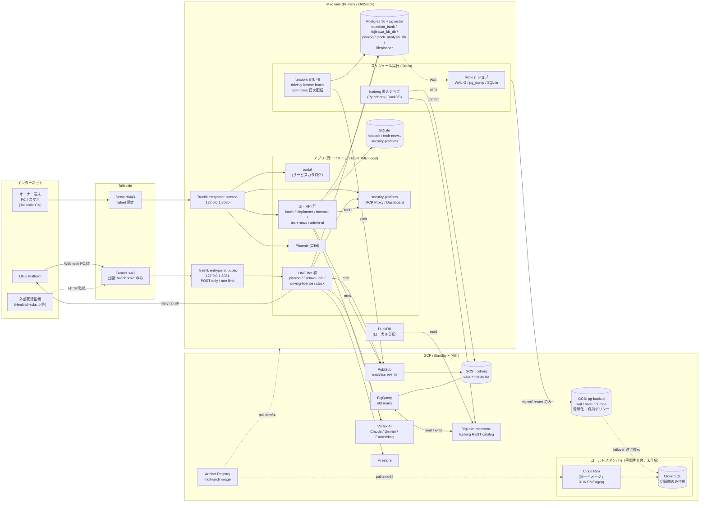
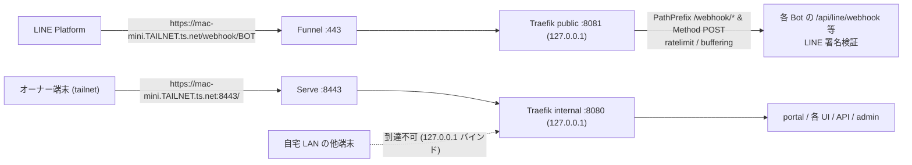
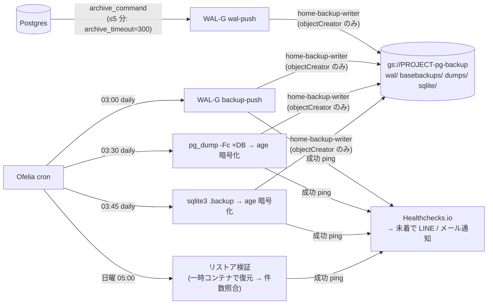
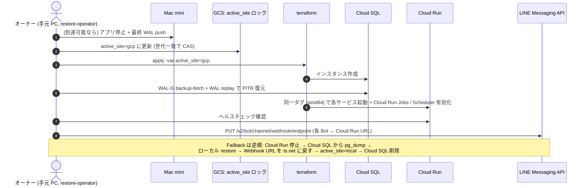

# PROPOSAL-0013: Mac mini ローカル本番化 + GCP コールドスタンバイ + Iceberg データ共有基盤

| | |
|---|---|
| **Status** | Draft |
| **Author** | @sakamoto-family-smile |
| **Created** | 2026-10-10 |
| **Updated** | 2026-10-10 |
| **Target** | cross-agent (全サービスのホスティング基盤 + analytics-platform + GCP インフラ全体) |
| **Related PRs** | (none yet) |
| **Supersedes** | — |
| **Superseded by** | — |

---

## 1. Summary

自宅の **Mac mini 上の Docker 環境をモノレポ全サービスの本番実行環境（Primary）** とし、GCP は
**同一コンテナイメージを即時配備できるコールドスタンバイ（Standby）** に切り替える。常時課金の Cloud SQL
（`shared-pg`）と常時起動の Cloud Run（`stock-analysis-line` の `min_instances=1` 等）を撤去し、固定費を
ほぼゼロにする。

外部からのアクセスは **Tailscale** に一本化する。人（オーナー 1 名）のアクセスは tailnet 内に閉じ
（**Tailscale Serve**）、インターネットへ公開するのは **LINE Webhook のパスだけ**（**Tailscale Funnel**）。
ルーターのポート開放・独自ドメインは不要。全サービスの入口に **ポータル（機能・サービス別ページ）** を置く。

業務データ（OLTP）は Mac mini の Postgres に置き、**WAL-G（継続アーカイブ）+ `pg_dump`（日次論理ダンプ）で
GCS に暗号化バックアップ**する。分析データは **GCS 上の Apache Iceberg テーブル（BigLake metastore を
カタログとする）** に置き、BigQuery とローカル DuckDB の双方から同じテーブルを参照する。

## 2. Motivation

- **固定費**: [PROPOSAL-0009](0009-gcp-cost-optimization.md) で Cloud SQL を 1 台（`shared-pg`, db-g1-small）に
  集約したが、なお常時課金が残る。加えて [PROPOSAL-0011](0011-stock-analysis-agent-line-gcp.md) の
  `stock-analysis-line` は BackgroundTasks 完了のため `min_instances=1` + CPU always-allocated で常時課金。
  家族規模のトラフィックに対し、常時起動リソースの比率が高い。
- **散在**: ローカル運用サービス（hotcook / lifeplanner / tech-news / kanie / security-platform 等）は
  各自の `docker-compose.yml` で個別起動しており、**ホストポートが衝突**（lifeplanner と stock がともに
  `8001`）、MCP Proxy も compose ごとに別インスタンス。一覧・死活確認できる入口がない。
- **外出先アクセス**: ローカルサービスは自宅 LAN 外から使えない。安全に使える経路が必要。
- **データの二重管理を避けたい**: 分析用途で BigQuery は残したいが、ローカル分析（DuckDB）と BigQuery で
  データのコピーを二重に持ちたくない。

### 2.1 Goals

- [ ] Mac mini 上の単一 compose スタックで全サービスを常時稼働させ、**ポータル**から各サービスに到達できる
- [ ] 外出先からオーナーが **Tailscale 経由でのみ** 全 UI / API にアクセスでき、インターネット公開面は
      **LINE Webhook パスのみ**である
- [ ] 現在 GCP で稼働中の 4 サービス（piyolog / fujisawa-info-bot / driving-license-bot / stock-analysis）と
      ETL / バッチを Mac mini に移行し、**Cloud SQL と常時起動 Cloud Run を撤去**する
- [ ] Postgres を **RPO ≤ 5 分**で GCS に暗号化バックアップし、週次で自動リストア検証する
- [ ] `make failover-gcp` 一発で **RTO ≤ 30 分**で GCP に切り替えられ、`make failback-local` で戻せる
- [ ] 分析データを GCS 上の Iceberg に置き、**BigQuery とローカル DuckDB から同一テーブル**を参照できる

### 2.2 Non-Goals

- **自動フェイルオーバー**（検知〜切替の自動化）。本提案では手動切替 + 通知まで（Phase 5 で再検討）
- **アクティブ-アクティブ構成**（Mac mini と GCP の同時書き込み）。常に片側のみがアクティブ
- **家族・第三者へのポータル公開**。利用者はオーナー 1 名（家族向けは LINE Bot 経由のみ）。
  将来必要になったら独自ドメイン + Cloudflare Access を追加する（§7 案 A）
- **完全オフライン動作**。Vertex AI / Anthropic API / Pub/Sub / Firestore 等の従量課金 SaaS は引き続き利用する
- 各サービスのアプリ機能追加（本提案はホスティング・データ基盤のみ）

---

## 3. Proposal

### 決定事項サマリ

| 論点 | 決定 |
|---|---|
| 本番実行環境 | Mac mini（Apple Silicon）+ OrbStack（Docker 互換） |
| 人のアクセス | Tailscale Serve（tailnet 限定）。利用者はオーナーのみ。独自ドメイン不要 |
| LINE Webhook | Tailscale Funnel で Webhook パスのみ公開。アプリの LINE 署名検証で防御 |
| 移行対象 | GCP 稼働中の LINE Bot 4 種 + ETL/バッチを全てローカルへ |
| OLTP DB | Mac mini の Postgres 16 + pgvector（`shared-pg` と同じ multi-DB 構成） |
| バックアップ | WAL-G（WAL 継続 + 日次ベース）+ 日次 `pg_dump`、GCS へクライアント側暗号化 |
| GCP の位置付け | コールドスタンバイ。切替時に terraform で Cloud SQL 作成 → 復元 → Cloud Run 起動 |
| 分析データ | GCS 上の Iceberg（BigLake metastore / Iceberg REST catalog）。BigQuery + DuckDB で共有 |
| イメージ | CI で multi-arch（arm64 / amd64）ビルド → Artifact Registry。両環境で同一タグを使用 |

### 3.1 User Stories

#### 3.1.1 外出先から家計シミュレーションを確認する
> 外出先でスマホの Tailscale を ON にし、`https://mac-mini.<tailnet>.ts.net:8443/` のポータルを開く。
> lifeplanner のページから UI を開いてシナリオを確認する。Tailscale を OFF にした端末や第三者からは
> URL 自体に到達できない。

#### 3.1.2 自宅が停電した
> 死活監視から「Mac mini 応答なし」が LINE に届く。30 分以上の復旧見込みがないため、手元の PC で
> `make failover-gcp` を実行。最新バックアップから Cloud SQL が復元され、Cloud Run が起動し、LINE の
> Webhook URL が Cloud Run に切り替わる。妻はいつも通り piyolog Bot を使い続けられる。復電後、
> `make failback-local` で Mac mini に戻し、Cloud SQL を削除する。

### 3.2 Notes / Constraints / Caveats

- **Funnel の制約**: 公開できるポートは 443 / 8443 / 10000 のみ。Funnel はポート単位で有効化されるため、
  **公開用（443, Funnel）と非公開用（8443, Serve のみ）でポートを分ける**（§4.2）。
- **LIFF**（lifeplanner `routes/line_liff.py`）は LINE 内ブラウザから開くため、オーナーの端末で Tailscale が
  ON なら tailnet 側 URL で動作する。家族に LIFF を開放する場合は Funnel 側に載せる必要がある（要再検討）。
- **Cloud Tasks / Pub/Sub push の受け口**: ローカルは外部から到達不能なため、GCP からの push 型呼び出しは
  使わない。`stock-analysis-agent` は `TASKS_ENABLED=false`（既存の `asyncio.create_task` フォールバック）で
  動作する。Mac mini は CPU 常時割当のため、Cloud Run で必要だった `min_instances=1` 問題は発生しない。
- **Pub/Sub publish（outbound）は継続利用**する（[PROPOSAL-0010](0010-analytics-platform-phase5-event-persistence.md) の
  イベント入口）。月 10 GiB の無料枠内。
- **Firestore**（driving-license-bot / fujisawa-info-bot）は従量課金で実質無料のため当面そのまま使う。
  ローカル Postgres への寄せ替えは別提案とする。
- **Apple Silicon**: 既存 Dockerfile はすべて `python:3.12-slim(-bookworm)` ベースで arm64 対応。
  Cloud Run は amd64 のみのため、CI で multi-arch ビルドする。
- **ストレージ egress**: GCS → 自宅のダウンロードはインターネット egress 課金（アジア 〜$0.12/GB 目安）。
  ローカル DuckDB からの Iceberg 読み取りはパーティション絞り込み・marts 中心とし、大量スキャンは BigQuery 側で行う。
- **BigLake metastore の Iceberg REST catalog** の GA 状況・料金・DuckDB/PyIceberg の対応バージョンは
  Phase 4 着手時に再確認する。

### 3.3 Risks and Mitigations

| リスク | 影響度 | 対策 |
|---|---|---|
| Funnel 公開面への攻撃（偽 Webhook、DoS） | High | 公開は Traefik `public` entrypoint（Webhook ルートのみ・POST のみ・レート制限・ボディサイズ制限）に限定。全 Bot で LINE 署名検証済（`routes/line.py`）。署名不正は 401 + 監査ログ |
| UI / API への不正アクセス | High | Traefik の全ポートを `127.0.0.1` バインド（LAN からも直接到達不可）。到達経路は tailscaled のみ。Tailscale は Google アカウント（2 段階認証必須）+ 端末承認 + ACL でオーナー端末 → Mac mini のみ許可 |
| Mac mini 侵害時のバックアップ破壊（ランサムウェア） | High | バックアップ用 SA は `storage.objectCreator` のみ（削除・上書き不可）。バケットに Object Versioning + 保持ポリシー（7 日）。復号鍵・読取 SA は Mac mini に置かない |
| 自宅の停電・回線断で LINE Bot 停止（一般利用者あり: fujisawa / driving-license） | Medium | 外部死活監視 + LINE 通知。30 分超見込みで `make failover-gcp`。UPS 導入。LINE の Webhook 再送設定を有効化 |
| データ消失（ディスク故障・誤操作） | High | WAL-G で RPO 5 分 + 日次 `pg_dump`（30 日 / 月次 12 か月）。週次自動リストア検証 |
| 二重アクティブによるデータ不整合 | High | `active_site` を terraform 変数 + GCS 上のロックオブジェクトで単一化。failover スクリプトはロック取得前に相手側の停止を確認（停止不能時は警告し、failback 時に差分を手動精査） |
| 秘密情報の漏洩 | High | `.env` は sops（age）で暗号化してコミット可能にし、平文はディスクに残さない（起動時復号）。GCP SA は用途別・最小権限・90 日ローテーション。gitleaks は既存 CI で継続 |
| Iceberg への複数エンジン同時書き込みによる破損 | Medium | **テーブルごとに書き込みエンジンを 1 つに固定**（§4.4.3）。カタログのコミットは楽観ロックで競合検知 |
| GCS egress 課金の想定外増加 | Low | 予算アラート（$5/月）。ローカル分析は marts 中心 |

---

## 4. Design Details

### 4.1 全体構成図



#### 構成要素一覧

| レイヤ | コンポーネント | 役割 |
|---|---|---|
| 入口 | Tailscale Serve / Funnel | 唯一の外部到達経路。TLS 証明書は Tailscale が自動発行（`*.ts.net`） |
| ルーティング | Traefik v3（2 entrypoint） | `internal`: 全ルート。`public`: Webhook ルートのみ。ルートは各サービスの compose `labels` で宣言 |
| ポータル | `portal/`（Next.js） | `catalog.yaml` を単一ソースにサービス別ページを生成。死活・アクティブサイト表示 |
| アプリ | 既存各サービス | イメージ不変。`RUNTIME` / `DATABASE_URL` 等の env のみで local / gcp を切替 |
| スケジューラ | Ofelia（Docker ラベル駆動 cron） | Cloud Scheduler + Cloud Run Jobs の置き換え。同一イメージ・同一コマンド |
| OLTP | Postgres 16 + pgvector（1 コンテナ multi-DB） | `shared-pg` と同じ DB 構成。ホストへポート非公開 |
| バックアップ | WAL-G + `pg_dump` + `sqlite3 .backup` | GCS へクライアント側暗号化で送出 |
| 分析 | Iceberg on GCS + BigLake catalog + BigQuery / DuckDB | データ実体を GCS に 1 つだけ持つ |
| 待機系 | Cloud Run + Cloud SQL（terraform `active_site=gcp` 時のみ） | コールドスタンバイ |

### 4.2 アクセス経路とセキュリティ



- **Tailscale 設定**（イメージ）

  ```bash
  # 公開: Webhook 専用 entrypoint のみを Funnel で 443 に出す
  tailscale funnel --bg --https=443 http://127.0.0.1:8081
  # 非公開: tailnet 内のみ 8443 で全ルートを出す
  tailscale serve  --bg --https=8443 http://127.0.0.1:8080
  ```

- **Tailscale ACL**（オーナーの端末から Mac mini の 8443 / 22 のみ許可）

  ```jsonc
  {
    "tagOwners": { "tag:home-server": ["autogroup:admin"] },
    "acls": [
      { "action": "accept", "src": ["autogroup:member"], "dst": ["tag:home-server:8443", "tag:home-server:22"] }
    ],
    "nodeAttrs": [ { "target": ["tag:home-server"], "attr": ["funnel"] } ]
  }
  ```

  - Tailnet ログインは Google アカウント（2 段階認証必須）。**Device approval** を有効化
  - Mac mini は `tag:home-server` で登録し、key expiry を無効化（タグ付きノード）。オーナー端末は key expiry 有効

- **Traefik public entrypoint のルール**
  - ルータは `traefik.http.routers.<svc>-webhook.entrypoints=public` を明示したものだけ
  - `PathPrefix(/webhook/<bot>) && Method(POST)` に限定し、`StripPrefix` で各アプリの既存パス
    （例: `/api/line/webhook`）へ書き換え
  - Middleware: `ratelimit`（例: 平均 20 req/s, burst 50）、`buffering`（maxRequestBodyBytes 1MB）
  - その他のパスは 404。ヘルスチェック用に `/webhook/_health`（GET 許可）だけ例外

- **ホスト / コンテナのハードニング**
  - FileVault 有効、macOS 自動アップデート、Docker は非管理者の専用ユーザーで運用
  - コンテナ: 非 root、`security_opt: [no-new-privileges:true]`、可能なものは `read_only: true` + `tmpfs`
  - Postgres / MCP Proxy 等は `internal: true` の Docker network のみに接続（ホストポート非公開）
  - 外部 MCP 呼び出しは従来どおり `security-platform` MCP Proxy 経由（compose 内で 1 インスタンスを共有）

- **秘密情報**
  - 各サービスの `.env` は `deploy/home/secrets/<svc>.env.sops` として age 暗号化でコミット。起動時に
    `sops exec-env` で注入し、平文ファイルは残さない
  - GCP SA（用途別、JSON キーは sops 管理・90 日ローテーション）:

    | SA | 権限 | 配置 |
    |---|---|---|
    | `home-runtime` | Vertex AI User, Pub/Sub Publisher, Firestore User, GCS（チャート画像バケット）objectAdmin | Mac mini |
    | `home-backup-writer` | `pg-backup` バケットの `storage.objectCreator` のみ | Mac mini |
    | `home-iceberg-writer` | Iceberg バケットの objectAdmin + BigLake catalog の書込 | Mac mini |
    | `restore-operator` | `pg-backup` 読取 + Cloud SQL / Cloud Run 管理 | **オーナーの端末のみ** |

### 4.3 サービス配置

| サービス | 現状 | 移行後（Primary = Mac mini） | 公開面 | DB |
|---|---|---|---|---|
| portal（新規） | — | `/` | internal | — |
| piyolog-analytics | Cloud Run | `/piyolog` | **public: `/webhook/piyolog`** | PG `piyolog` |
| fujisawa-info-bot | Cloud Run | `/fujisawa` | **public: `/webhook/fujisawa`** | PG `fujisawa_kb_db`（pgvector）+ Firestore |
| fujisawa-platform ETL ×8 | Cloud Run Jobs + Scheduler | Ofelia スケジュール | — | PG `fujisawa_kb_db` |
| driving-license-bot line-bot | Cloud Run | `/driving-license` | **public: `/webhook/driving-license`** | PG `question_bank` + Firestore |
| driving-license-bot admin-ui | Cloud Run | `/driving-license-admin` | internal | PG `question_bank` |
| driving-license-bot batch | Cloud Run Job + Scheduler | Ofelia（夜間） | — | PG `question_bank` |
| stock-analysis-agent | Cloud Run（min=1） | `/stock` | **public: `/webhook/stock`** | PG `stock_analysis_db` |
| lifeplanner-agent | ローカル | `/lifeplanner` | internal（LINE 利用時は public 追加） | PG `lifeplanner` |
| hotcook-agent | ローカル | `/hotcook` | internal | SQLite |
| tech-news-agent | ローカル | `/tech-news` + Ofelia（日次配信） | internal | SQLite |
| kanie-lab-agent | 未配備 | `/kanie`（frontend）, `/api/kanie`（backend） | internal | Firestore |
| security-platform | ローカル | `/security`（Dashboard）+ MCP Proxy（内部） | internal | SQLite |
| analytics-platform | ローカル | `/phoenix`（Phoenix UI）+ dbt / Iceberg ジョブ | internal | DuckDB / Iceberg |

- パス方式ルーティング。FastAPI は Traefik `StripPrefix` + uvicorn `--root-path /<svc>` で `/<svc>/docs` が
  動作（アプリコード変更なし）。Next.js（kanie / portal）は `basePath` を env で設定可能にする。
- 各サービスの既存 `docker-compose.yml` は単体開発用として残し、統合スタックは `deploy/home/` に別定義する
  （build context はリポジトリルート。path dep の `../analytics-platform` 等を解決するため）。

### 4.4 データ設計

#### 4.4.1 OLTP（Postgres）

- `pgvector/pgvector:pg16` イメージ 1 コンテナに、`shared-pg` と同じ DB / ユーザーを作成
  （`question_bank` / `fujisawa_kb_db` / `piyolog` / `stock_analysis_db` + 新規 `lifeplanner`）
- アプリは env `DATABASE_URL`（または既存の `DB_HOST` 系）を `postgres:5432` に向けるだけ。
  Cloud SQL Unix ソケット（`/cloudsql/...`）との差分は env のみ
- 初回移行は Cloud SQL から `pg_dump -Fc` → ローカル `pg_restore`（§4.6）

#### 4.4.2 バックアップ



| 種類 | 頻度 | 保持 | 用途 |
|---|---|---|---|
| WAL（WAL-G, libsodium 暗号化） | 継続（最大 5 分間隔） | 7 日 | PITR / failover 復元 |
| ベースバックアップ（WAL-G） | 日次 03:00 | 7 世代 | 同上 |
| 論理ダンプ（`pg_dump -Fc` × DB, age 暗号化） | 日次 03:30 | 日次 30 日 + 月次 12 か月 | 単一 DB 復元・誤操作復旧・メジャーバージョン移行 |
| SQLite（`.backup`, age 暗号化） | 日次 03:45 | 30 日 | hotcook / tech-news / security-platform |

- バケット: Object Versioning 有効、Retention policy 7 日、Lifecycle（30 日超を Nearline、期限超過で削除）
- 目標: **RPO ≤ 5 分 / RTO ≤ 30 分**。週次リストア検証結果はポータルに表示

#### 4.4.3 分析データ（Iceberg）

| データ | 書き込みエンジン（唯一） | 格納 | 読み取り |
|---|---|---|---|
| イベントログ raw | Pub/Sub GCS サブスク（0010） | GCS raw（JSONL） | BigQuery external table |
| イベント staging / marts | BigQuery（dbt） | **BigQuery 管理の Iceberg テーブル**（GCS） | BigQuery, DuckDB（read-only） |
| OLTP 分析スナップショット（piyolog 記録, 出題履歴, ポートフォリオ等） | ローカル Iceberg 書込ジョブ（PyIceberg / DuckDB） | **外部書込の Iceberg テーブル**（GCS, BigLake catalog 登録） | BigQuery（BigLake Iceberg table）, DuckDB |

- **原則: 1 テーブル 1 ライター**。BigQuery が書くテーブルはローカルから書かない（逆も同じ）
- カタログは **BigLake metastore（Iceberg REST catalog）に一本化**。ローカルは PyIceberg / DuckDB の
  REST catalog 接続、BigQuery はネイティブ参照
- 書込ジョブは日次（Ofelia）。GCS 不達時はローカルに Parquet で保留し、次回まとめて append
- dbt は既存の BigQuery 実行を継続（月 1 TiB 無料枠内の見込み）。ローカルは DuckDB で marts を参照

### 4.5 切り替え（Failover / Failback）

**切り替え = 「LINE Webhook・API の受付と DB 書き込みを担うアクティブサイトを Mac mini ⇄ GCP で入れ替える操作」**。
瞬断（数分の再起動等）では行わず、30 分以上の停止見込み・計画メンテナンス時に実施する。



- **`active_site` の単一化**: terraform 変数と GCS 上のロックオブジェクト（generation 条件付き更新）で管理。
  Mac mini のアプリは起動時にロックを確認し、`gcp` なら Webhook / 書込系を起動しない
- **切替対象**: LINE Bot 4 種 + ETL / バッチ。オーナー専用 UI（kanie / hotcook 等）は原則切替対象外
- **年 1 回以上の切替訓練**（Phase 3 完了条件として初回実施）

### 4.6 ディレクトリ構成（追加分）

```
deploy/home/
  compose.yaml               # 統合スタック（profiles: core / bots / apps / analytics / batch）
  compose.override.yaml      # Mac 固有 (volume パス等)
  traefik/traefik.yml        # entrypoints: internal(:8080) / public(:8081)
  traefik/dynamic/*.yml      # ratelimit / buffering / stripPrefix
  postgres/init/*.sql        # DB / ユーザー作成
  backup/                    # WAL-G 設定, dump / restore-verify スクリプト
  secrets/*.env.sops         # age 暗号化済み env
  tailscale/serve.sh         # serve / funnel 設定の冪等適用
  scripts/failover-gcp.sh
  scripts/failback-local.sh
  Makefile                   # up / down / update / logs / backup-now / failover-gcp / failback-local
portal/
  catalog.yaml               # サービス一覧の単一ソース
  app/                       # Next.js (docs/diagrams/systems/* を流用)
terraform/standby/           # active_site 変数で Cloud SQL / Cloud Run を作成・削除
.github/workflows/
  build-images.yml           # buildx multi-arch → Artifact Registry
```

各サービスの既存 `terraform/` は `active_site` 変数を受けて `count` で Cloud Run / Jobs / Scheduler を 0 にできるよう改修する。

### 4.7 Test Plan

- **Unit**
  - ポータル: `catalog.yaml` スキーマ検証（必須キー・重複 id・health パス）
  - failover スクリプト: ロック CAS の競合・`active_site` 判定ロジック（pytest + GCS モック）
  - Iceberg 書込ジョブ: スキーマ進化・パーティション・GCS 不達時のローカル保留
- **Integration**
  - `docker compose up` 後、全サービスの health を Traefik 経由で叩くスモークテスト（CI で amd64、Mac で arm64）
  - `public` entrypoint: Webhook 以外のパス 404、GET 405、署名不正 401、レート超過 429 を確認
  - バックアップ → 一時コンテナへの復元 → テーブル件数照合（週次ジョブと同じスクリプトを CI でも実行）
  - PyIceberg で書いたテーブルを BigQuery / DuckDB で読めること（検証用データセット）
- **Manual / E2E**
  - [ ] tailnet 外の端末（モバイル回線・Tailscale OFF）から 8443 に到達できない
  - [ ] 自宅 LAN の別 PC から Mac mini の 8080 / 8081 / 5432 に到達できない
  - [ ] 各 LINE Bot が Funnel 経由で応答する（実機）
  - [ ] `make failover-gcp` → LINE 応答確認 → `make failback-local` の通し訓練（所要時間を記録し RTO 30 分以内）
  - [ ] Healthchecks.io の通知（バックアップ停止・Mac mini 停止）が LINE に届く

### 4.8 Migration / Rollback

サービス単位で段階移行する（piyolog → stock → driving-license → fujisawa の順。トラフィックと影響範囲の小さい順）。

1. Mac mini で対象サービスを起動（Webhook 未切替、`active_site` ロックは `gcp` のまま = 書込系待機）
2. Cloud Run を停止（または Webhook を一時的に無効化）→ Cloud SQL から対象 DB を `pg_dump -Fc` → ローカルへ `pg_restore`
3. 対象 Bot の Webhook URL を `ts.net` に切替、動作確認
4. Cloud Run の対象サービス / Jobs / Scheduler を `count = 0` に
5. 全サービス移行・1 回目の切替訓練完了後、Cloud SQL `shared-pg` を最終ダンプ取得のうえ削除

- **Rollback**: 各ステップで Webhook URL を Cloud Run に戻すだけで旧構成に復帰可能（Cloud SQL 削除前まで）。
  ローカルで発生した書込は `pg_dump` で Cloud SQL に戻す
- **既存ユーザー影響**: 切替時に数分の応答停止。LINE の Webhook 再送を有効にして取りこぼしを抑える

### 4.9 Feature Enablement

| env / 変数 | 値 | 効果 |
|---|---|---|
| `RUNTIME` | `local` / `gcp` | ストレージ・認証情報取得方法・DB 接続方式の切替 |
| `DATABASE_URL`（または既存 `DB_HOST` 系） | `postgres:5432` / `/cloudsql/...` | DB 接続先 |
| `TASKS_ENABLED`（stock） | `false`（local） | Cloud Tasks を使わず in-process 実行 |
| `ANALYTICS_STORAGE_BACKEND` | `pubsub`（両環境） | 0010 のイベント入口 |
| terraform `active_site` | `local` / `gcp` | GCP 側リソースの作成有無 |

---

## 5. Operational Concerns

### 5.1 Monitoring

- **外部死活**: Healthchecks.io 等から Funnel の `/webhook/_health` を 5 分間隔で監視 → LINE / メール通知
- **バックアップ**: 各ジョブ完了時に ping。未着で通知（§4.4.2）
- **ポータル**: 全サービスの health、`active_site`、最終バックアップ時刻、週次リストア検証結果を表示
- **セキュリティ**: Traefik public のアクセスログ（401 / 429 の急増）を security-platform の通知に連携
- **コスト**: GCP 予算アラート $5/月

### 5.2 Troubleshooting

| 症状 | 原因 / 対処 |
|---|---|
| LINE Bot が応答しない | Funnel 状態（`tailscale funnel status`）→ Traefik public ログ → アプリログの順に確認。Mac mini 停止なら §4.5 |
| 外出先からポータルが開けない | 端末の Tailscale ON / Device approval / ACL を確認。8443 指定漏れに注意 |
| `/svc/docs` が壊れる | `--root-path` と `StripPrefix` の不一致 |
| WAL-G の push 失敗が続く | GCS 権限（objectCreator）、回線、ディスク逼迫（`pg_wal` 肥大）を確認。逼迫時は手動 `backup-push` |
| BigQuery から Iceberg テーブルが最新にならない | 書込ジョブの commit 失敗 / カタログ接続を確認。BigQuery 管理テーブルは metadata export のタイミングに依存 |
| Mac mini 再起動後に一部サービスが起動しない | OrbStack のログイン時起動設定、`restart: unless-stopped`、sops 復号鍵の読み取り権限を確認 |

### 5.3 Dependencies

- Tailscale（Serve / Funnel / ACL）、OrbStack、Traefik v3、Ofelia、WAL-G、sops / age
- LINE Messaging API（Webhook endpoint 更新 API を failover で使用）
- GCP: Artifact Registry / GCS / Pub/Sub / BigQuery / BigLake metastore / Vertex AI / Firestore /
  （切替時のみ）Cloud SQL・Cloud Run・Cloud Scheduler
- 既存提案: [0009](0009-gcp-cost-optimization.md)（Cloud SQL 集約の後継として撤去）/
  [0010](0010-analytics-platform-phase5-event-persistence.md)（イベント入口）/
  [0011](0011-stock-analysis-agent-line-gcp.md)（stock の GCP 配備をスタンバイ化）

### 5.4 Non-Functional Requirements

#### 性能 (Performance)
- LINE Webhook: 受信〜200 応答 1 秒以内（重い処理は既存の ack → push 非同期パターン）
- Mac mini（メモリ 16GB 以上推奨）で全 profile 同時起動できること。不足時は profile で起動対象を絞る

#### コスト (Cost)

| 項目 | 現状（目安） | 移行後（目安） |
|---|---|---|
| Cloud SQL `shared-pg` | 常時課金（月 $30 前後） | $0（切替時のみ時間課金） |
| Cloud Run（stock min=1 ほか） | 常時課金あり | $0（待機） |
| Cloud Scheduler / Jobs | 少額 | $0 |
| GCS（バックアップ + Iceberg） | 少額 | 〜$1/月 |
| BigQuery / Pub/Sub | 無料枠内 | 無料枠内 |
| Tailscale | — | $0（Personal プラン） |
| Mac mini 電気代 | — | 月数百円 |

※ 単価は導入時に GCP 料金表で再確認する。

#### プライバシー / データ保持
- 家計・育児記録等の PII は自宅 Postgres と暗号化バックアップのみ。GCS 上はクライアント側暗号化
- Iceberg（分析）には PII を載せない（0010 と同じく ID はハッシュ化）

#### 可用性
- Mac mini 単一ノード。目標 RPO 5 分 / RTO 30 分（手動切替）。UPS 推奨

---

## 6. Drawbacks

- **単一障害点が自宅になる**: 停電・回線断・Mac mini 故障で一般利用者向け Bot（fujisawa / driving-license）も止まる。
  Cloud Run のマネージドな可用性を手放す
- **運用負荷の増加**: OS アップデート、ディスク監視、バックアップ検証、切替訓練をオーナーが担う
- **Funnel の制約**: `*.ts.net` のホスト名（tailnet 名が露出）、帯域・ポート制限。将来の公開範囲拡大には不向き
- **Iceberg の複雑さ**: 家族規模ではコスト削減効果は小さく、主目的は「データ実体の一元化・ロックイン回避」。
  運用が重い場合は Phase 4 を見送り BigQuery ネイティブテーブルに留める判断もあり得る

## 7. Alternatives

### 案 A: Cloudflare Tunnel + Cloudflare Access
- 概要: cloudflared の outbound トンネル + Access（Google IdP・メール許可リスト・MFA）で公開。独自ドメインで任意サブドメイン可
- 却下理由: 利用者がオーナー 1 名のみの現時点では、独自ドメイン取得・DNS 管理が追加コスト。
  Tailscale のほうが「そもそもインターネットから見えない」ため攻撃面が小さい。**家族へのポータル開放時に再検討**

### 案 B: Cloud Run は残し、DB だけ安価な外部マネージド（Neon / Supabase 無料枠）へ
- 概要: 可用性は GCP に任せ、Cloud SQL の固定費だけ削る
- 却下理由: ローカル運用サービスの統合・外出先アクセスの課題が解決しない。外部 DB は無料枠の制限
  （コンピュート停止・容量）と、pgvector / 既存 asyncpg 接続の検証コストがある。stock の `min_instances=1` 費用も残る

### 案 C: アクティブ-アクティブ（Mac mini と GCP を常時併用、DB レプリケーション）
- 概要: Cloud SQL をレプリカにして自動フェイルオーバー
- 却下理由: Cloud SQL 常時課金が残り、本提案の主目的（固定費削減）と矛盾。家族規模に対し過剰

### 案 D: Iceberg を使わず BigQuery ネイティブテーブル + ローカルへ定期エクスポート
- 概要: 分析は BigQuery に集約し、ローカル分析用に Parquet を定期ダウンロード
- 却下理由: データのコピーが二重化し、鮮度管理が必要。Iceberg ならテーブル実体を GCS に 1 つだけ持ち、
  エンジンを選べる。ただし Phase 4 で運用負荷が見合わなければ本案にフォールバックする

---

## 8. Implementation History

### フェーズ計画

| Phase | 内容 | 完了条件 |
|---|---|---|
| P1 入口 | `deploy/home/` 統合 compose、Traefik（2 entrypoint）、ポータル、Tailscale Serve。ローカル運用サービス（stock API / hotcook / lifeplanner / tech-news / kanie / security / phoenix）を収容 | 外出先から tailnet 経由で全 UI に到達、LAN / インターネットから不達 |
| P2 DB ローカル化 | Postgres + WAL-G + dump + リストア検証、Funnel（public entrypoint）、multi-arch CI。piyolog → stock → driving-license → fujisawa（+ ETL / batch の Ofelia 化）の順で移行 | 4 Bot が Funnel 経由で応答、RPO 5 分のバックアップ稼働 |
| P3 待機系 | `active_site` 変数化、`terraform/standby/`、failover / failback スクリプト、切替訓練 1 回 | 訓練で RTO 30 分以内を確認後、Cloud SQL `shared-pg` 削除 |
| P4 Iceberg | BigLake catalog、イベント marts の BigQuery 管理 Iceberg 化、OLTP スナップショット書込ジョブ、DuckDB 参照 | BigQuery と DuckDB で同一テーブルを参照 |
| P5 高度化 | 自動フェイルオーバー検討、家族向けポータル公開（案 A）検討 | — |

| 日付 | 種別 | 内容 |
|---|---|---|
| 2026-10-10 | Draft | 初稿 |
