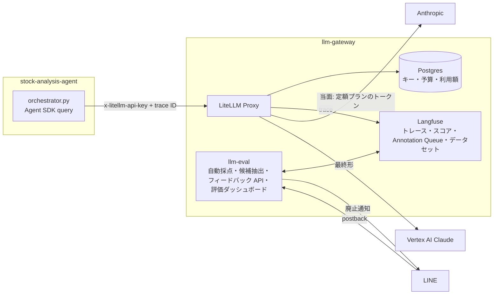
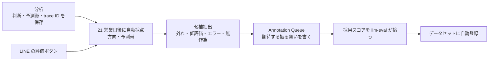

# PROPOSAL-0014: LLM Gateway（LiteLLM + Langfuse + 評価データセット）を stock-analysis-agent から導入する

| | |
|---|---|
| **Status** | In Review |
| **Author** | @sakamoto-family-smile |
| **Created** | 2026-11-15 |
| **Updated** | 2026-11-22 |
| **Target** | llm-gateway (新規) + stock-analysis-agent |
| **Related PRs** | 本 PR (設計) |
| **Supersedes** | — |
| **Superseded by** | — |

---

## [必須] 1. Summary

新しい `llm-gateway/` を monorepo に足し、LiteLLM Proxy・Langfuse・評価サービス（llm-eval）の 3 つを、
同じコンテナ構成でローカル（Mac mini）と GCP のどちらでも動かす。最初の到達点は
「stock-analysis-agent の全 LLM 呼び出しが gateway を通り、21 営業日後の実績で自動採点された
評価データセットがダッシュボードで育っていく状態」。

構成は設計メモ（LLM Gateway 設計メモ。以下「設計メモ」）の推奨どおりパターン C（自前ホストの中央 gateway）。
プロバイダの認証情報は gateway だけが持ち、エージェントは gateway のバーチャルキーだけを持つ。
課金の最終形は Vertex AI の従量課金とし、Vertex AI のクォータが取れるまでは
いまの定額プラン（Claude Max）のトークンを gateway 経由でそのまま Anthropic に渡して使う。

## [必須] 2. Motivation

- LLM の呼び出しがサービスごとにばらばらで、費用・遅延・エラーを横断して見る場所がない。
  stock-analysis-agent は analytics-platform に `total_cost_usd` を送っているが、トレース単位では追えない。
- モデル名（`claude-opus-4-6`）がコードに直書きされており、EOSL のたびにコード変更とデプロイが要る。
  廃止日を知る仕組みもない。
- 分析の質を測る評価データがない。強気・中立・弱気の判断は本文の文章にしかなく、
  モンテカルロの予測帯（P10〜P90、21 営業日）は保存していない。フィードバックの手段もない。
- 株価予測は「21 営業日後の実際の株価」という答えが後から手に入るので、
  評価データを自動採点で厚くできる。これを活かさないのはもったいない。

### [必須] 2.1 Goals

- [ ] stock-analysis-agent の LLM 呼び出しがすべて gateway 経由になり、分析 1 回が Langfuse の 1 トレースにまとまる
- [ ] エージェントは別名（`stock-analysis` / `stock-analysis-next`）だけを呼び、実際のモデルの切り替えが gateway の設定変更 1 つで済む
- [ ] モデルの廃止日の 30 / 7 / 1 日前に LINE で通知される
- [ ] 方向の的中・予測帯の的中・利用者の評価の 3 つが自動でスコアとして付き、レビューを経て評価データセットに登録される
- [ ] ローカル ⇄ GCP の切り替え（#264 の `cutover-to-local` / `cutover-to-gcp`）に gateway 一式が組み込まれ、往復してもトレースとデータセットが残る

### [必須] 2.2 Non-Goals

- 他サービスの gateway 移行（stock-analysis-agent で一巡した後に別提案にする）
- 入出力のガードレール、MCP Gateway、Enterprise 版の機能（SSO・監査ログ・JWT 認証）
- プロンプトの自動最適化（設計メモの P5）と、judge の結果による自動デプロイ
- 新旧モデル比較の自動実行（設計メモの P4）。データセットと別名の仕組みだけ今回用意し、比較は通知を受けて手で回す

---

## [必須] 3. Proposal

### 3.0 スコープ

設計メモの P0〜P3 のうち、家族用の規模で意味のある部分を stock-analysis-agent 1 本で一巡させる。

| 区分 | 内容 |
| --- | --- |
| やる | LiteLLM Proxy と Langfuse の自前ホスト（ローカルの docker compose と GCP の両方） |
| やる | stock-analysis-agent の LLM 呼び出しをすべて gateway 経由にし、プロバイダへの直接の権限を外す（S1） |
| やる | 分析 1 回を 1 トレースにまとめ、session ID と trace ID を付ける（S2） |
| やる | 評価データセットの候補抽出・レビュー・登録の仕組みと、状況を見るダッシュボード（P3 の一部） |
| やる | ローカルから GCP へ、設定の切り替えだけで移れる手順と移行スクリプト |
| やらない | 2.2 Non-Goals のとおり |

### [推奨] 3.1 User Stories

#### 3.1.1 モデルの廃止に気づける
> Opus 4.6 の廃止 30 日前に LINE に通知が届く。後継モデルを `stock-analysis-next` に割り当て、
> 評価データセットで新旧を比べてから、gateway の設定だけで `stock-analysis` を切り替える。エージェントのコードは触らない。

#### 3.1.2 分析の当たり外れが見える
> 評価ダッシュボードで、月別の方向的中率と予測帯の的中率（目安 80%）を見る。
> 外れた分析は Annotation Queue に自動で入り、「期待する振る舞い」を書いて採用するとデータセットに登録される。

### [推奨] 3.2 Notes / Constraints / Caveats

- **課金方式（決定）**: 最終形は Vertex AI の従量課金。Vertex AI のクォータが取れるまでは定額プランのトークンを gateway に通す。
  - gateway は `x-litellm-api-key` のバーチャルキーで認証し、`Authorization` の定額プランのトークンをそのまま Anthropic に渡す（LiteLLM の [Claude Code Max subscription](https://docs.litellm.ai/docs/tutorials/claude_code_max_subscription) 対応）。
  - Vertex AI への切り替えは、gateway の設定で別名 `stock-analysis` の向き先を `vertex_ai/` に替えるだけ。エージェント側は触らない。
  - 定額プランの間は、利用上限を普段の Claude Code と共有する。Langfuse の費用は API 料金換算の参考値になる。
  - Anthropic は Agent SDK を使うサービスには API キーかクラウドの認証を求めている。定額プランは個人利用の間のつなぎとして扱う。
- **Vertex AI の現状（2026-11-21）**: Claude のモデルは見えるがクォータが 0 で、global の全モデルで 429。
  Opus 4.6 と Opus 5.5（クォータ上の base model は `anthropic-claude-opus`）の global クォータ引き上げを Cloud Quotas API で申請したが、
  毎分リクエスト数 2 まで下げても数秒で自動却下された。値ではなくプロジェクトか請求先アカウントの条件で弾かれているとみられ、
  コンソールからの申請とサポート経由の審査を別途進める。
- **費用の試算（2026-11-15）**: GCP 稼働中（2026-06-11〜07-29）の分析 18 件は、API 料金換算で平均 0.70 ドル
  （上位 1 割で 0.88 ドル、最大 1.10 ドル）、平均 22 ターン。月 30 件なら約 21 ドル、月 100 件なら約 70 ドル。
  トークンの大半はプロンプトキャッシュなので、gateway 経由でもキャッシュが効くことが前提。
- **Langfuse の置き場所（決定）**: 稼働中の環境に置き、切り替え時に移す。
- **中立とみなす幅（決定）**: 銘柄ごとの変動率に合わせる。値は P0 で過去の分析に当てて決める。
- **Brave Search の MCP** は今どおり security-platform の MCP プロキシを通し、gateway には入れない。

### [必須] 3.3 Risks and Mitigations

| リスク | 影響度 | 対策 |
|---|---|---|
| Agent SDK との相性。プロンプトキャッシュやツール呼び出しが gateway で落ちると費用や結果が変わる | High | Anthropic 形式（`/v1/messages`）のまま受けて渡し、変換を最小にする。P0 でキャッシュの効きを切り替え前と比べる |
| 定額プランのトークンとバーチャルキーを一緒に送ると 401 になる報告がある（[BerriAI/litellm#29190](https://github.com/BerriAI/litellm/issues/29190)） | High | P0 の最初にこの組み合わせを確かめ、通るバージョンか設定を選ぶ |
| 単一障害点。gateway が止まると分析がすべて止まる | Medium | 既存のヘルス監視に gateway を足し、LINE に知らせる。直接呼びには逃がさず、分析は失敗として返す |
| 費用の増加（定額から従量へ） | Medium | バーチャルキーに月の予算上限を設定する。既存の分析回数の上限も残す |
| Mac mini の資源。Langfuse（特に ClickHouse）はメモリを使い、stock-analysis-agent は今 4 GB の上限で動いている | Medium | P0 で実測する。足りなければ Langfuse を GCP の VM に常設する案に変える |
| gateway イメージの改ざん（設計メモにある LiteLLM の PyPI パッケージ改ざんの事例） | Medium | イメージをダイジェストで固定し、security-platform の検査を通してから手で上げる |
| 採点の偶然。21 営業日後の方向は相場全体に左右され、分析の質をそのままは表さない | Low | 的中率は月単位の傾向と候補抽出にだけ使う。分析の質はレビューで書いた「期待する振る舞い」で測る |
| 評価ダッシュボードの露出 | Low | ローカルは Tailscale の内側だけ、GCP は IAP などで本人だけが見られるようにする |

---

## [必須] 4. Design Details

### 4.1 アーキテクチャ概略

stock-analysis-agent 以外の 4 つ（LiteLLM Proxy、その Postgres、Langfuse、評価サービス）を `llm-gateway/` に置き、
ローカルでも GCP でも同じイメージと設定で動かす。

分析 1 回は Agent SDK の中で複数回 LLM を呼ぶため、エージェントが分析ごとの trace ID を付け、
Langfuse 上で 1 トレースにまとまるようにする。

| 部品 | 役割 | 置き場所 |
| --- | --- | --- |
| LiteLLM Proxy | Anthropic 形式（`/v1/messages`）で受けて Claude に渡す。モデルは `stock-analysis` などの別名で指定し、実際のモデル名は gateway の設定だけに書く | `llm-gateway/litellm/`（設定は git 管理、イメージはダイジェストで固定） |
| Postgres（gateway 用） | バーチャルキー、予算、利用額 | ローカルはコンテナ、GCP は既存の `shared-pg` に DB を 1 つ足す |
| Langfuse | トレース、スコア、Annotation Queue、データセット、標準のダッシュボード | `llm-gateway/langfuse/`（公式の docker compose 構成をそのまま使う） |
| 評価サービス（llm-eval） | 自動採点、候補の抽出とキュー投入、承認分のデータセット登録、フィードバック API、評価ダッシュボード、廃止通知 | `llm-gateway/eval/`（Python、FastAPI） |

#### ローカルと GCP

どちらも同じイメージ・同じ設定ファイルで動かし、違いは「どこで動くか」と「秘密の置き場所」だけにする。
エージェントから見て変わるのは `ANTHROPIC_BASE_URL` の 1 つだけ。

| 部品 | ローカル（Mac mini） | GCP |
| --- | --- | --- |
| LiteLLM Proxy | compose のコンテナ。エージェントと同じ内部ネットワークだけに公開 | Cloud Run サービス `llm-gateway`（asia-northeast1） |
| Postgres（gateway 用） | compose のコンテナ | `shared-pg` に DB `litellm_db` を足す |
| Langfuse | 公式の compose（web、worker、Postgres、ClickHouse、Redis、MinIO） | GCE の VM 1 台で同じ compose。オブジェクトストレージだけ GCS |
| 評価サービス | compose のコンテナ（定期処理はコンテナ内のスケジューラ） | Cloud Run サービス（定期処理は Cloud Scheduler） |
| gateway → Vertex AI の認証 | Vertex AI の利用権限だけを持つ SA のキー。gateway のコンテナにだけマウント | gateway の SA そのもの（キーなし） |
| バーチャルキー・マスターキー | `config/*.env`（git 管理外） | Secret Manager |

- **Langfuse を Cloud Run に載せない**: Langfuse v3 は ClickHouse という状態を持つ DB が必須で、Cloud Run には向かない。VM に同じ compose を置けばローカルと構成が一致する。VM の大きさは P0 で実測して決める。
- **バーチャルキーを両方に同じ値で登録する**: LiteLLM はキー発行時に値を指定できる。両環境で同じキーが通るので、切り替え時にキーを配り直さなくてよい。
- **GCP では gateway を内部公開にする**: gateway の認証ヘッダは Cloud Run の IAM 用トークンと並べにくい。gateway は内部からの通信だけを受け、エージェントの Cloud Run に VPC 経由の送信を足す。いま VPC の設定は無いので、ここが GCP 側でいちばん新しい作業になる（P0 で疎通を確かめる）。

#### モデルの制限と EOSL

| 仕組み | 内容 |
| --- | --- |
| 使えるモデルの制限 | エージェントのバーチャルキーには、別名 `stock-analysis` と試験用の `stock-analysis-next` だけを許可する。実際のモデル名を直接指定した呼び出しは gateway が断る |
| 予算と速度の上限 | キーごとに月の予算上限と、時間あたりの呼び出し回数の上限を設定する |
| 廃止日の把握 | gateway の設定に載っているモデルごとに廃止日を持つ。LiteLLM のモデル情報にある廃止日を使い、プロバイダの公開情報と食い違う場合は手で上書きする（どちらを正とするかは P0 で決める） |
| 通知 | LiteLLM 標準の廃止アラートはメールと管理画面だけなので、評価サービスが毎日廃止日を調べ、30 日前、7 日前、1 日前に LINE で知らせる。通知には、そのモデルを直近 30 日に使ったキーを並べる |
| 後継モデルへの切り替え | 後継モデルを `stock-analysis-next` に割り当て、評価データセットで新旧を比べる。問題がなければ `stock-analysis` の割り当てを変える |

### 4.2 データモデル

- **stock-analysis-agent `reports`**: 予測帯（P10〜P90、21 営業日）、基準日の終値、判断（強気・中立・弱気）と確信度、trace ID を足す（Alembic の移行を 1 本追加）。
- **Langfuse**: 自動採点の 3 スコアを元のトレースに付ける。

| スコア | 採点の仕方 | 入る時期 |
| --- | --- | --- |
| 方向の的中 | 判断と 21 営業日後の騰落率を比べる。中立とみなす幅は銘柄ごとの変動率に合わせる | 分析の 21 営業日後 |
| 予測帯の的中 | 実際の終値が P10〜P90 の帯に入ったか。正しく較正されていれば入る割合は約 80% | 分析の 21 営業日後 |
| 利用者の評価 | LINE の「役に立った」「いまいち」 | 押されたとき |

- **llm-eval**: 評価ダッシュボード用の集計テーブル（月別・判断別の的中率、データセットの件数推移）。

評価データセットを作る流れ（人の作業は「期待する振る舞い」を書いて採用を選ぶことだけ）:

### 4.3 API

- **LiteLLM Proxy**: Anthropic 形式の `/v1/messages`。別名 `stock-analysis` / `stock-analysis-next`。
- **llm-eval**:
  - フィードバック API（LINE の postback を受ける）
  - 評価ダッシュボード（読むだけ。ラベル付けは Langfuse の Annotation Queue を使う）

ダッシュボードは 3 つの画面に分ける。

| 画面 | 見るもの | 実現手段 |
| --- | --- | --- |
| 運用 | 分析あたりの費用、遅延、エラー率、モデル別の利用量 | Langfuse 標準のダッシュボードと LiteLLM の管理 UI |
| 予測精度 | 月別・判断別の方向的中率、予測帯の的中率（目安 80%）、利用者評価の推移 | llm-eval の画面（Langfuse の API と自前の集計テーブル） |
| データセット | 登録件数の推移、レビュー待ち件数、採用率、候補の内訳 | 同上 |

評価ダッシュボードを自前にするのは、BigQuery（analytics-platform）や Langfuse のエクスポート機能に頼ると GCP でしか見られないため。
llm-eval の画面ならローカルでも GCP でも同じものが見られる。BigQuery への連携は他サービスに広げる段階で検討する。

### 4.4 主要モジュール

stock-analysis-agent の LLM 呼び出しは `app/agents/orchestrator.py` の `query()` 1 か所だけで、ここに渡す環境変数を差し替えれば S1 が終わる。

| 変更 | いま | 変更後 |
| --- | --- | --- |
| 接続先と認証 | `CLAUDE_CODE_OAUTH_TOKEN`（定額プラン）で直接 | `ANTHROPIC_BASE_URL` = gateway、`ANTHROPIC_CUSTOM_HEADERS` = `x-litellm-api-key: <バーチャルキー>`。`CLAUDE_CODE_OAUTH_TOKEN` は定額プランの間は残し、`ANTHROPIC_AUTH_TOKEN` は設定しない（設定すると定額プランのトークンの代わりに送られる）。Vertex AI に移ったら OAuth トークンを Secret Manager から消す |
| モデル | `claude-opus-4-6` をコードに直書き | 設定 `LLM_MODEL` で別名 `stock-analysis` を指定 |
| トレース | OTel の span と analytics-platform のイベントのみ | 分析ごとに trace ID を発行し、ヘッダで gateway に渡す。Agent SDK は分析ごとに CLI を起動するため、環境変数で分析単位のヘッダを付けられる |
| 判断の構造化 | 強気・中立・弱気は本文中の文章だけ。`sentiment` は空のまま | レポート末尾に判断と確信度を決まった形式で出させ、読み取って保存する |
| 予測の保存 | モンテカルロの予測帯は保存していない | `reports` に保存（4.2） |
| フィードバック | なし（LINE はテキストのイベントだけ処理） | レポートに評価ボタンを付け、postback を llm-eval のフィードバック API に送る |

既存の計測（analytics-platform の `llm_call` や `total_cost_usd`）はそのまま残し、gateway の利用額と突き合わせて迂回がないことを確かめるのに使う。

#### 実装計画

P0 の検証のあと、ローカルで一巡させてから GCP に広げる。各 PR の時点で stock-analysis-agent が動く状態を保つ。

| 順 | 内容 | 完了の確認 |
| --- | --- | --- |
| P0 検証 | 手元で LiteLLM と Langfuse を立て、Agent SDK → gateway → Claude が、ストリーミング・ツール呼び出し・MCP 込みで動くかを確かめる。定額プランのトークンの受け渡し（#29190）、キャッシュの効き、廃止アラート、ヘッダの Langfuse への反映、ClickHouse のバックアップと復元の所要時間も確かめる | 既存の分析 1 件が gateway 経由で同じ形のレポートを返し、Langfuse に 1 トレースとして載る |
| PR1 gateway 一式（ローカル） | `llm-gateway/` を新設。LiteLLM の設定、compose、キー発行スクリプト、`make up` など。イメージはダイジェストで固定し、security-platform の検査対象に登録する | `make up` だけで起動し、試験呼び出しが通る |
| PR2 エージェントの接続 | 接続先・キー・モデルの別名を設定に出す。trace ID の付与、判断の構造化、予測帯の保存（Alembic の移行） | Mac mini の本番が gateway 経由で動き、新しい分析に判断と予測帯が保存される |
| PR3 評価サービス | 自動採点、候補抽出とキュー投入、採用分の自動登録、フィードバック API、評価ダッシュボード、廃止通知。エージェントに LINE の評価ボタンを足す | 過去の分析で採点が通り、レビューから登録までが 1 件通る |
| PR4 GCP | Terraform（gateway と llm-eval の Cloud Run、SA、Secret Manager、`shared-pg` の DB、Langfuse の VM と GCS、VPC 経由の送信）。自動デプロイの対象にも加える | GCP 側だけで試験呼び出しと採点が通る |
| PR5 移行手順 | `cutover-to-gcp` / `cutover-to-local` に gateway 一式を組み込む。両方向のリハーサルをする | Mac mini → GCP → Mac mini と往復しても、トレースとデータセットが残る |

### [必須] 4.5 Test Plan

- **Unit**: 自動採点（方向・予測帯・中立の幅）、判断の読み取り、候補抽出の条件、廃止日の通知タイミング（30 / 7 / 1 日前）
- **Integration**: compose で gateway 一式を立て、試験呼び出しが Langfuse に 1 トレースとして載ること。許可外のモデル名が断られること。フィードバック API がスコアを付けること
- **Manual / E2E**:
  - [ ] 既存の分析 1 件が gateway 経由で同じ形のレポートを返す（定額プランの経路）
  - [ ] プロンプトキャッシュの読み出し量が切り替え前と同程度
  - [ ] Mac mini → GCP → Mac mini と往復しても、トレースとデータセットが残る

### [推奨] 4.6 Migration / Rollback

- **Migration**: `reports` への列追加（Alembic 1 本）。gateway 一式は既存の切り替え手順に組み込む。
  1. 切り替え先で gateway、Postgres、Langfuse、llm-eval を起動する（設定は git、秘密は既存の `secrets-pull` / `secrets-push` に足す）
  2. 切り替え元の Langfuse と gateway の DB を止めてバックアップし、GCS 経由で切り替え先に戻す
  3. 切り替え先の gateway で試験呼び出しを 1 回通し、Langfuse にトレースが届くことを確かめる
  4. エージェントを既存の手順で切り替える
  5. 切り替え元の gateway 一式を止める（GCP 側は既存の standby と同じく、インスタンス数 0 と VM の停止）
- **Rollback**: エージェントの `ANTHROPIC_BASE_URL` と `ANTHROPIC_CUSTOM_HEADERS` を外せば、定額プランでの直接呼び出しに戻る（Vertex AI 移行前に限る）。
- **既存ユーザー影響**: LINE の見た目はレポートの評価ボタンが増えるだけ。

### [推奨] 4.7 Feature Enablement

- エージェントは `ANTHROPIC_BASE_URL` の有無で gateway 経由かどうかが決まる。
- 定額プランと Vertex AI の切り替えは gateway の設定（別名の向き先）だけで行う。

---

## [推奨] 5. Operational Concerns

### 5.1 Monitoring

- 運用の数字は Langfuse 標準のダッシュボードと LiteLLM の管理 UI で見る。
- gateway の利用額と analytics-platform の `total_cost_usd` を突き合わせ、gateway を迂回した呼び出しがないことを確かめる。
- gateway は既存のヘルス監視に足し、止まったら LINE に知らせる。

### 5.2 Troubleshooting

| 症状 | 原因 / 対処 |
|---|---|
| gateway が 401 を返す | 定額プランのトークンとバーチャルキーの組み合わせ（#29190）。`ANTHROPIC_AUTH_TOKEN` が設定されていないかも確かめる |
| Vertex AI で 429 | クォータが 0 のまま。3.2 の申請状況を確かめる |
| 費用が急に増えた | プロンプトキャッシュが gateway で効いていない可能性。Langfuse でキャッシュ読み出し量を見る |

### 5.3 Dependencies

- LiteLLM Proxy、Langfuse v3（Postgres、ClickHouse、Redis、MinIO / GCS）
- Anthropic（定額プランの間）、Vertex AI（最終形）
- LINE Messaging API（評価ボタン、廃止通知）
- security-platform（イメージの検査、MCP プロキシ）
- #264 の切り替え手順、Cloud SQL `shared-pg`、Secret Manager

### [推奨] 5.4 Non-Functional Requirements

#### コスト (Cost)
- LLM 呼出: 3.2 の試算のとおり、従量課金なら月 30 件で約 21 ドル、月 100 件で約 70 ドル
- ストレージ / 計算: GCP 側は Langfuse 用の VM 1 台と GCS が増える。稼働していない側は止める

#### プライバシー / データ保持
- プロンプトと応答は Langfuse に残る。評価ダッシュボードは本人だけが見られるようにする

---

## [推奨] 6. Drawbacks

- 部品が 4 つ増え、Mac mini の資源と切り替え手順の手間が増える。
- gateway が単一障害点になる。

## [必須] 7. Alternatives

### 案 A: gateway を置かず、各サービスに Langfuse の SDK を直接入れる
- 概要: 計測だけを入れ、呼び出しはサービスから直接行う。
- 却下理由: モデルの制限・予算・EOSL の切り替えをサービスごとに持つことになり、認証情報も各サービスに残る。

### 案 B: Langfuse Cloud を使う
- 概要: Langfuse を自前ホストせず SaaS を使う。
- 却下理由: プロンプトと応答を外部に出すことになる。ローカルと GCP の切り替えの方針とも合わない。

### 案 C: Langfuse を GCP の VM に常設する
- 概要: 稼働中の環境に関係なく、Langfuse は常に GCP に置く。
- 却下理由: ローカル稼働中も GCP の費用がかかる。Mac mini の資源が足りなかった場合の代替として残す。

### 案 D: 課金を Anthropic API の従量課金にする
- 概要: Vertex AI ではなく Anthropic API のキーを gateway に持たせる。
- 却下理由: GCP の請求と認証に揃えるため、最終形は Vertex AI とした。Vertex AI のクォータが取れない間のつなぎは、追加費用のかからない定額プランを使う。

---

## [必須] 8. Implementation History

| 日付 | 種別 | 内容 |
|---|---|---|
| 2026-11-15 | Draft | 初稿。Langfuse の置き場所と中立の幅を決定 |
| 2026-11-21 | Draft | Vertex AI のクォータ申請が自動却下された経緯を追記 |
| 2026-11-22 | In Review | 課金方式を決定（最終形は Vertex AI、当面は定額プランを gateway に通す）。本 PR |
