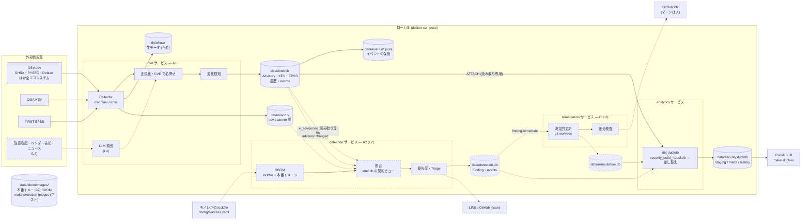
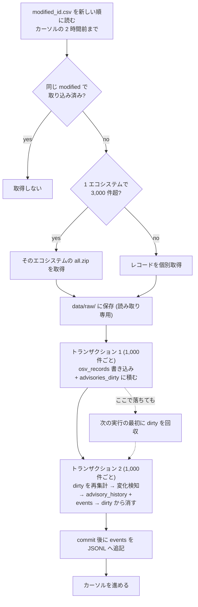

# 脆弱性対応フレームワーク (ローカル優先)

外部の脆弱性情報を取り込み (A1)、社内資産と照合し (A2)、依存ライブラリの改修を
PR まで自動で進める (B) ためのフレームワーク。まずはローカルで常駐させ、
情報を運用 DB (SQLite) に集約し、分析用に DuckDB へ蓄積する。

| 段階 | 範囲 | 状態 |
|---|---|---|
| L0 | `data/` レイアウト、SQLite 3 ファイル + Alembic、イベント (outbox + JSONL)、dbt 雛形、`services.yaml`、docker compose | ✅ |
| L1 | A1: OSV 全エコシステム (全量 + 差分)、CISA KEV、FIRST EPSS、名寄せ、変化検知、ブートストラップ。分析: 鮮度・リードタイム・エコシステム別・KEV カバレッジ | ✅ |
| L2 | A2: lockfile の照合・優先度 (✅)。本番イメージ (OS パッケージ・ランタイム本体・同梱ライブラリ) の照合 (✅)。LINE / GitHub Issues 通知、取得停止のアラート (⬜) | 🔶 |
| L3 | B: git worktree での決定的更新、差分検査、PR 作成 | ⬜ |
| L4 | A1 の非構造ソース: IPA・JPCERT 注意喚起、ベンダー告知、セキュリティニュース、VulnerableMCP。LLM で根拠付き抽出し、一次情報が見つからないものは `unconfirmed` として照合に使わない | ⬜ |

## アーキテクチャ

実線が実装済み (L0 / L1)、点線が今後の段階。



境界の決まりは 3 つ。

- 運用 DB 1 ファイルにつき書き込むサービスは 1 つ。他のサービスの DB は `mode=ro` で開く
- サービス間はイベントでつなぐ。発行側 DB の `events` を受信側がカーソル付きで読む (GCP では Pub/Sub に置き換える)
- 分析は運用 DB を読み取り専用で ATTACH するだけで、運用側に書き戻さない

### 毎時の差分取り込み (intel)

途中で落ちても取りこぼさないよう、トランザクションの区切りを次のようにしている。



## 使い方

Docker Compose v2.24 以降が必要。コンテナはホストの UID で動く (`make up` が `HOST_UID` / `HOST_GID` を渡す)。

```bash
cd security-platform
make up                           # mkdir -p data && docker compose up -d --build。初回はブートストラップから
docker compose logs -f intel      # = make logs-vuln
make duck-ui                      # ホストで DuckDB UI を開く (http://localhost:4213)
```

単発で動かす場合 (どれも `docker compose run` でコンテナ内から実行する):

```bash
make vuln-migrate        # data/{intel,detection,remediation}.db を作成
make intel-bootstrap     # 初回全量 (中断しても続きから再開)
make intel-osv           # OSV 差分 / intel-osv-full / intel-kev / intel-epss
make intel-health        # 情報源ごとの最終成功時刻 (古いものがあれば exit 1。DB には書かない)
make detection-scan      # lockfile・本番イメージを照合して findings を更新 (常駐の detection も 1 時間ごとに実行)
make detection-findings  # 未対応の Finding を優先度・期限順に表示
make detection-images    # 本番イメージの SBOM を作る (これだけホストで実行。下記)
make analytics           # dbt build → data/security.duckdb を差し替え
```

SQLite に書くのはコンテナの中からだけにする。ホストの macOS から `uv run` で書くと、
Docker Desktop の VM をまたいで同じ WAL ファイルを共有することになり、壊れる恐れがある。
同じ VM の中では `data/.locks/<name>.lock` (flock) で書き込みを 1 プロセスに絞っており、
常駐中の intel のジョブと手動実行が重なると、後から来た方が `WriterBusy` ですぐ失敗する。

コンテナに渡す設定は `config/vuln.env` だけ (雛形 `config/vuln.env.example`)。
`config/.env` の API キーなどはコンテナに渡さない。主な設定:

| 変数 | 既定 | 内容 |
|---|---|---|
| `OSV_ECOSYSTEMS` | (全部) | 対象エコシステム (CSV)。全量取得・差分取得の両方に効く |
| `HEALTHCHECK_PING_BASE` | (なし) | 例 `https://hc-ping.com/<ping-key>`。ジョブの成否を `sec-<job>` に ping する |
| `RAW_RETENTION_DAYS` | 30 | KEV・EPSS・OSV 差分の生データ保持日数 |
| `OSV_RAW_FULL_SNAPSHOTS_KEPT` | 2 | OSV 全量の保持世代数 (完了した実行だけを数える) |
| `MIN_FREE_DISK_GB` | 10 | 空きがこれを下回ったら全量のダウンロードを止める |
| `IMAGE_SBOM_MAX_AGE_DAYS` | 7 | 本番イメージの SBOM がこれより古いと照合時に警告する |

`make detection-images` はホストで動くので、環境変数か `config/.env` の `GCP_PROJECT`
(空なら gcloud の既定のプロジェクト) と `SYFT_IMAGE` (既定はダイジェスト固定の syft) を読む。

## 運用 (ローカル常駐)

- **止まったことに気づく**: Mac のスリープ・Docker Desktop の停止・再起動後の未ログインで取得は止まる。
  `HEALTHCHECK_PING_BASE` を設定し、監視側 (Healthchecks.io など) で ping が途絶えたら通知させる。
  あわせて「スリープしない」設定と Docker Desktop の自動起動を有効にしておく
- **失敗時の再試行**: ジョブが失敗すると 5 分 → 10 分 → 20 分 … と倍々に待つ (上限 6 時間、
  かつ実行間隔まで)。全量取得が途中で失敗したら、その実行で落としたファイルはすぐ消す
- **データ量の目安** (2026-10 時点の実測): OSV 全量 約 3.2GB (45 エコシステム)、
  `modified_id.csv` 約 150MB、変更は 1 日 1 万件前後 (多い日は 18 万件)、KEV 約 2MB、EPSS 1 日 約 3MB。
  KEV は内容が変わったときだけ、EPSS は `score_date` が変わったときだけ生データを保存する
- **404 のレコード**: `modified_id.csv` に載っているのに本文が 404 のものは `osv_missing` に記録し、
  次の差分取得から最大 24 回取り直す。`make intel-health` に件数が出る。OSV 側での削除の検出は未対応
- **バックアップ**: 生データと osv-scanner DB は取り直せるが、次は作り直せない。
  `data/intel.db` の `advisory_history` / `events` / `source_runs`、`data/security.duckdb` の
  `history.*`、`data/events/`。これらを毎日、暗号化して外部に退避する
  (SQLite は `sqlite3 data/intel.db ".backup ..."` をコンテナ内で実行する)
- **イベントの受信側**: `seq` は DB ファイルの中でだけ意味を持つ。受信側はカーソルと一緒に
  発行側の `db_info.epoch` を持ち、DB が作り直されたら 0 から読み直す。payload には `schema_version` が入る
- **時刻**: DB には UTC で保存する。dbt のセッションも UTC に固定している (スナップショットの時刻がずれないように)

## データの持ち方

| 層 | 場所 | 書き込み元 | 役割 |
|---|---|---|---|
| 生データ | `data/raw/<source>/dt=YYYY-MM-DD/` | intel | 取得したものを改変せず保存 (書き込み後は読み取り専用)。OSV 全量は新しい 2 世代を保持 |
| 運用 DB | `data/intel.db` | intel のみ | Advisory・KEV・EPSS・変化履歴・取得記録・イベント |
| | | `data/detection.db` | detection のみ | Finding・SBOM・照合の実行記録・イベント |
| | `data/remediation.db` | (L3) | スキーマのみ作成済み |
| SBOM | `data/sbom/images/<service_id>.json` + `blobs/sha256-<digest>.cdx.json` | `make detection-images` (ホスト) | 本番イメージの SBOM (CycloneDX)。ダイジェストごとに 1 つ、参照されなくなったら消す |
| イベント | 各 DB の `events` + `data/events/type=*/dt=*/<producer>.jsonl` | 発行側 | 受信側は発行側 DB を読み取り専用で開き、自分の `event_cursors` で位置を持つ |
| 分析 DB | `data/security.duckdb` | analytics | dbt で組み立てる。スキーマ `staging` / `marts` / `history` |
| osv-scanner DB | `data/osv-db/osv-scanner/<ecosystem>/all.zip` | intel | A2 (L2) のオフライン照合用。OSV 全量取得のたびに更新 |

DuckDB を運用 DB にしないのは、同時に書き込めるのが 1 プロセスだけで、書き込み中は他から
開けないため。dbt は `security_build_<ランダム>.duckdb` に作ってから `security.duckdb` に置き換えるので、
UI で開いたままでも更新は止まらない (開き直すと新しい内容が見える)。
intel のブートストラップが終わるまでは dbt snapshot (とその下流) を実行しない。
取り込み途中の状態を「変化」として履歴に残さないため。

## A1 の取り込み

| 情報源 | ジョブ | 間隔 | 方法 |
|---|---|---|---|
| OSV (GHSA・PYSEC・各ディストリビューション等を含む) | `osv` | 1 時間 | ルートの `modified_id.csv` (新しい順) をカーソルまで読み、変更レコードを個別取得。1 エコシステムで 3,000 件を超えたらそのエコシステムは `all.zip` で取り直す |
| | `osv_full` | 7 日 | 全エコシステムの `all.zip` を再取得 (取りこぼしの回収と osv-scanner DB の更新) |
| CISA KEV | `kev` | 1 時間 | 全件 JSON |
| FIRST EPSS | `epss` | 1 日 | 全件 CSV.gz |

ブートストラップ (初回) はエコシステム単位で進捗を記録するので、中断しても続きから再開する。
差分カーソルの起点は最初に開始した時点の値に固定するので、再開までの間の更新も取りこぼさない。
差分取得はカーソルの 2 時間前から読み (エクスポートの遅れ対策)、同じ `modified` で取り込み済みのものは取得しない。
レコードの書き込みと同じトランザクションで「再集計待ち (`advisories_dirty`)」を積むので、
再集計の途中で落ちても次の実行で回収される。形式の壊れたレコードは飛ばして `source_runs.skipped` に数える。
KEV のスナップショットが既存件数の半分未満なら壊れているとみなして反映しない。
ブートストラップ中は `advisory.changed` も履歴も書かず、取り込み結果を変化検知の基準値にする。
完了時に `advisory.bootstrap_completed` を 1 件だけ発行する。全エコシステムの全量は
数 GB のダウンロードと、マシンによって数十分〜1 時間程度の処理になる見込み
(PyPI 単体で約 2.7 万件 / 40 秒を確認)。

### 名寄せ (Advisory)

OSV レコードを CVE 番号で 1 件の Advisory にまとめる (`src/intel/grouping.py`)。

- CVE がちょうど 1 つ → その CVE 番号が `advisory_id` (GHSA・PYSEC・DEBIAN-CVE などが合流)
- CVE が 2 つ以上 (USN・DSA などのまとめ告知) → 連鎖的な合流を避けるため自分の ID で独立
- CVE なし → エイリアス先の既存レコードに合流、無ければ自分の ID

深刻度は自分のレコードの最大 CVSS、無ければ深刻度ラベル (AlmaLinux 等は summary 先頭の
`Important:` 等から補う) で決める。どちらも無いときは `upstream` に挙がった Advisory 自身の深刻度の
最大を引き継ぐ (Chainguard・Wolfi の CVE なしレコード、USN・DSA などのまとめ告知)。引き継ぎは 1 段だけで、
upstream 側の深刻度が変わったら引き継いでいる Advisory も再集計する。`cvss_score` は自分のものだけを持つ。

KEV・EPSS は Advisory 行に持たず、`v_advisories` ビューで含む CVE から都度引く。
KEV にだけ載っている CVE (主に製品の脆弱性) は、パッケージ情報の無い Advisory として作る。

### 変化の種類 (`advisory.changed` の `change_types`)

`created` / `removed` (別 Advisory に合流) / `withdrawn` / `reinstated` /
`fixed_version_published` / `affected_changed` / `severity_changed` / `aliases_changed` /
`kev_added` / `kev_removed` / `epss_increased` (0.1 以上の上昇)。
1 回の実行で同じ Advisory に複数の変化があっても 1 イベントにまとめる。

## A2 の照合 (lockfile・本番イメージ)

`detection` サービスが 1 時間ごとに `config/services.yaml` の全サービスを照合する (`src/detection/`)。
モノレポは `/repo` に読み取り専用でマウントし、コンテナは外部と通信しない (`network_mode: none`)。

1. lockfile (`uv.lock` / `package-lock.json` v2 以降) と本番イメージの SBOM からコンポーネントを作る。
   lockfile では本番で読み込まれるもの (`runtime`) と、開発用の依存からしか届かないもの (`dev`) を分ける。
   同じパッケージが両方にあれば 1 つにまとめる (本番イメージに入っていれば `runtime`)
2. intel.db の契約ビューで照合する。範囲 (ECOSYSTEM / SEMVER) はバージョン順にイベントを評価し、
   範囲を持たない項目 (悪性パッケージ等) は列挙バージョンで照合する。取り下げ済みは照合しない
3. 優先度と期限を付けて findings と突き合わせる (新規 `open`・変化 `updated`・該当しなくなったら `resolved`)。
   lockfile を読めなかったサービスの Finding は閉じない

| 優先度 | 条件 | 期限 |
|---|---|---|
| P1 | 悪性パッケージ、または KEV 掲載 | 1 日 |
| P2 | Critical、または EPSS 10% 以上 | 7 日 |
| P3 | High | 30 日 |
| P4 | それ以外 | なし |

P1 以外は、dev 依存のみ、または未稼働・非公開のサービスなら 1 段下げる (重ねては下げない)。
OS パッケージ (Debian) で修正版がまだ無いものは、P1 以外は P4 (期限なし) にする
(こちらで打てる手が無いため。修正版が出れば本来の優先度に戻り、そこから期限を数える)。
優先度が上がったら期限を今から数え直して早め、下がったら初回検知から数え直す。
変化は detection.db の `finding.opened` / `finding.reopened` / `finding.updated` / `finding.resolved` に出る。
分析 DB では `marts.mart_open_findings` / `marts.mart_findings_by_service` で見る。

### 本番イメージの照合

`services.yaml` の `images` に Cloud Run のサービス (`cloud_run`) かジョブ (`cloud_run_job`) を書くと、
本番で今動いているイメージを照合する。detection コンテナはネットワークを持たないので、
イメージの取得と SBOM の生成だけはホストで行う。

```bash
make detection-images   # = uv run python -m src.detection images (gcloud にログイン済み・docker が動くこと)
```

1. `gcloud run services|jobs describe` で今のイメージを調べ、Artifact Registry でダイジェストに解決する
2. まだ SBOM の無いダイジェストだけ syft (`SYFT_IMAGE`、ダイジェスト固定) で CycloneDX にする。
   レジストリの認証は `gcloud auth print-access-token` の短命なトークンを環境変数で渡す
3. `data/sbom/images/<service_id>.json` を書き換える。1 つでも調べられなかったサービスは前回のまま残す

権限は Cloud Run の閲覧 (`run.services.get` / `run.jobs.get`) と Artifact Registry の読み取りがあればよい。
デプロイのたびに実行する。SBOM が `IMAGE_SBOM_MAX_AGE_DAYS` (既定 7 日) より古いと照合時に警告し、
`images` に書いたのに SBOM が無いサービスは照合が欠けているものとして Finding を閉じない。

| 中身 | エコシステム | 照合のしかた |
|---|---|---|
| OS パッケージ (`pkg:deb/debian`) | `Debian:<メジャー版>` | ソースパッケージ名 (purl の `upstream`) と Debian のバージョン (dpkg の比較規則) |
| 実行環境の本体 (`/usr/local` の python・node、NodeSource の nodejs) | `Bitnami` | 上流のバージョン番号 (Bitnami の Advisory は上流の版で範囲を持つ) |
| 同梱ライブラリ (`pkg:pypi` / `pkg:npm`) | `PyPI` / `npm` | lockfile と同じ。ベースイメージの pip など lockfile に無いものも拾う |

Ubuntu・Alpine の OS パッケージやその他の種類は SBOM には残すが、照合は未対応 (件数だけ数える)。

## A2・B への読み取り契約

`data/intel.db` を `mode=ro` で開き、次のビューだけを使う (テーブルを直接読まない)。

| ビュー | 内容 |
|---|---|
| `v_advisories` | Advisory + `kev` / `kev_date_added` / `epss` / `epss_percentile` |
| `v_advisory_affected` | 影響パッケージ (ecosystem / name / purl / ranges / fixed / versions)。`versions_json` は範囲 (ECOSYSTEM / SEMVER) で判定できない項目 (悪性パッケージなど) だけが持ち、他は NULL |
| `v_advisory_aliases` | 別名 (GHSA・PYSEC・DSA など) |

## 分析 DB の中身

| スキーマ.テーブル | 内容 |
|---|---|
| `marts.mart_source_freshness` | 情報源ごとの最終成功時刻、経過時間、24 時間の実行・失敗件数 |
| `marts.mart_advisory_lead_time` | 同じ CVE が各情報源 (GHSA / PYSEC / KEV ...) に載った時刻と最初からの遅れ |
| `marts.mart_advisories_by_ecosystem` | エコシステム別の件数と深刻度・KEV・修正版ありの内訳 |
| `marts.mart_kev_coverage` | KEV 掲載 CVE のうちパッケージ単位で照合できるもの |
| `marts.mart_daily_changes` | 日別・変化の種類別の件数 |
| `history.snp_advisories` / `history.snp_kev` | dbt snapshot による変更履歴 (SCD2)。EPSS は毎日ほぼ全件動くので対象外 |
| `staging.*` | 運用 DB を型付けしたもの |

```sql
-- 例: 情報源の鮮度
SELECT source, hours_since_success, last_status, failures_24h FROM marts.mart_source_freshness;
-- 例: どの情報源が一番早く載るか
SELECT source_db, count(*) FILTER (WHERE is_first) AS firsts, median(lag_hours) AS median_lag_h
FROM marts.mart_advisory_lead_time GROUP BY 1 ORDER BY firsts DESC;
```

DuckDB の `sqlite` 拡張を使う。初回に extensions.duckdb.org から自動で入る
(Docker イメージにはビルド時に同梱)。

## 既知の制約

- 取得停止のアラート (FR-I07) は `HEALTHCHECK_PING_BASE` の外部監視で受ける。LINE への直接通知は L2 で入れる
- osv-scanner DB は全量取得 (7 日ごと) のタイミングでしか更新されない。L2 で差分の反映方法を決める
- NVD・JVN・ランタイムのリリース情報・OneCRL・非構造ソース (注意喚起・ニュース) は未対応
- 既存の `src/collector/` / `src/analyzer/` (data/security.db) は当面そのまま残し、L2 で置き換える
- A2 のイメージ照合は Debian の OS パッケージと Python・Node.js の本体まで。Ubuntu・Alpine・Go などのバイナリに組み込まれたものは照合しない
- 本番イメージの SBOM はホストの `make detection-images` で作る (自動では更新しない)。デプロイ後に実行し忘れると、7 日後から照合時に警告が出る
- Debian の Advisory は Debian 公式のパッケージを前提にしている。Debian 以外の apt リポジトリから入れたものは、既知のもの (NodeSource の nodejs) だけ上流の版で照合し、それ以外は誤検知になり得る
- CVE の無いレコード同士の合流は取り込み順に依存する (CVE のあるものは順序に依存しない)。別名の連鎖は、キーが変わったレコードを辿って付け直す
- OSV 側で削除されたレコードは検出しない (404 は `osv_missing` に残るだけ)
- 止まっていた間の OSV の途中の変化は取り戻せない (OSV は最新版しか配らない)。EPSS は過去日のファイルがあるが、埋め戻しコマンドは未実装
- dbt は運用 DB を ATTACH して読むため、取り込み中に build するとテーブルごとに読む時点が少しずれることがある
- イベントの JSONL ミラーは commit 後に書くので、その間に落ちると JSONL だけ欠ける (正本は各 DB の `events`)
